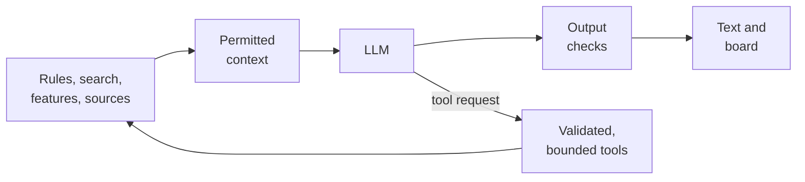

# LLM and symbolic design

A brief map of the mechanisms combined across Kibitz's features. **Built** includes working prototypes; **Partial** distinguishes existing pieces from remaining work; **Planned** refers to [TODO](TODO.md); **Exploration** refers to [ROAD](ROAD.md). Status updated 2026-10-23. Implementation details are in [ARCH](ARCH.md); background and research are linked below.

## The composition

- **Rules and state:** chess.js validates positions and moves; the application owns game history, clocks, scratch variations and permissions.
- **Search and evaluation:** separate complete Stockfish opponent and analyst instances produce moves, scores and continuations. Stockfish itself combines NNUE neural evaluation with explicit search; Kibitz uses its UCI results, not standalone neural representations.
- **Features and records:** pure chess features, motif candidates, checked tactical evidence, opening data, game occurrences and reference metadata make the position queryable.
- **Language and intent:** the LLM explains, summarises and requests tools from the evidence supplied. The application decides what evidence and actions are permitted.

## Across the features

| Feature and status | Explicit mechanism | LLM contribution and combination |
| --- | --- | --- |
| **Play, analysis, hints, move ratings — Built** | Legal game state, opponent search, analyst scores/PVs and score-change classification. | Optional explanation of permitted results. Playing and measuring need no LLM. |
| **Tutor commentary and questions — Built** | Current position, checked lines, motifs, themes, recent dialogue and selected aspects form a bounded context. | Explain the position at the player's level; request more evidence when tools are available. |
| **Review and study suggestions — Built/prototype** | Analyse positions, identify mistakes/key moments and aggregate themes. | Summarise the evidence and suggest study topics. Full longitudinal weakness tracking remains planned (9). |
| **Chat commands and “what if” — Built** | Local command parsing, typed library/board tools, legal scratch moves, reanalysis and undo. | Translate flexible requests into tool calls and explain their results. Plain commands also work without a model. |
| **Board annotations and variations — Built** | Parse supported move lines and the bounded `board` grammar; check marks against the position before rendering. | Propose arrows, squares and explanations anchored to checked evidence; the renderer owns board changes. |
| **Reading and similar games — Built/prototype** | Rank reference metadata/theme tags; retrieve games by exact EPD or pawn signature and classics by theme. | Explain why the returned reference fits. This retrieves metadata/positions, not book passages. |
| **Opening library — Partial; 5** | Position-based names, the reference-game explorer, repertoire editing and spaced recall drills exist. EPD/route matches retrieve authored opening guides; current pawn patterns select separate structure notes. Recall grades and intervals are deterministic. | Static guides and drills work without a model. The coach adapts quoted study notes to permitted position context and checks concrete alternatives with Stockfish. Named continuation browsing remains planned (5.6). |
| **Lessons and progress — Planned; 6/9** | Existing challenges seed theme progress. Planned lessons combine authored examples, verified motifs, grading rules and eligible tablebase checks. | Adapt explanations and staged hints; diagnosis/lesson selection uses recorded attempts. Generated wording does not determine move correctness. |
| **Library and richer RAG — Partial; 7/8** | PGN parsing, own games and bounded metadata search exist. Provenance, deduplication, text indexes, embeddings and hybrid reranking remain planned. | Map natural-language intent to validated queries, then synthesise retrieved evidence with citations. |
| **Visible options, plans and piece power — Exploration; ROAD 1/2/4/9** | Candidate lines, attack/defence relations and bounded plan checks supply board evidence. Corner dots count actual relations. | Explain options and relationships. A proposed plan needs checking; a model does not invent the counts. |
| **Similarity by aspect — Exploration; ROAD 10** | Compare position, material, pawn, relation and continuation features under an explicit aspect/profile; learned encoders are research candidates. | Explain the analogy and its differences. Similarity selects examples; advice is checked again in the current position. |

Voice input/output (ROAD 5) would connect speech recognition and synthesis to the same validated command/answer path. Courses and mobile wrappers would reuse these boundaries.

## Concepts that recur

- **Context engineering and policy:** fixed coach rules, aspect templates, player level and position-specific evidence. Live-help settings filter context and tool availability before a request; general chat has separate history without board context.
- **Tool use and bounded agency:** the page runs validated engine/library/board calls, capped at four rounds and six calls per answer, with separate engine budgets. Unsupported models fall back to supplied context. Saved library data is outside the board tools' write scope; leaving play requires confirmation and preserves a return path.
- **Structured output and verification:** named JSON formats and tool schemas constrain machine-facing data; chat board marks use a small grammar. Prose moves, piece/square claims and displayed lines undergo separate chess checks. Parsing successfully does not establish truth.
- **Retrieval and provenance:** structural keys and tags ground current references. Passage/vector retrieval is planned; text-graph retrieval is an exploration. Position/move graphs, attack/defence graphs and text-derived entity graphs represent different relationships.
- **State consistency and isolation:** asynchronous results check game generation/FEN; scratch analysis leaves the running game intact. Scores use White's perspective and EPD caching; history-dependent draw claims need more than that key.
- **Runtime and resource policy:** provider adapters and an optional in-browser model share the coach interface. Task routing, local-only settings, caches, cancellation and usage budgets control execution. Keys stay server-side; imported text is quoted and output rendered as text.

## What the checks establish

Legal moves, checked position facts, finite-search assessments and retrieved statements carry different evidence. A motif candidate needs tactical confirmation; an unchecked move stays distinguishable from a backed line. Neither a legal PV nor a valid citation proves the causal explanation in the prose.

Logic/UI tests and provider mocks cover rules, tools, state and workflows; the tutor evaluation set measures commentary. Labelled retrieval benchmarks and learner-outcome evaluation remain planned. Relevance, chess correctness and explanation quality are assessed separately.

Read next: [architecture](ARCH.md), [research index](research/README.md), [position-similarity study](research/position-similarity.md), or the [Primer](primer/Primer_v01.pdf) for background.
