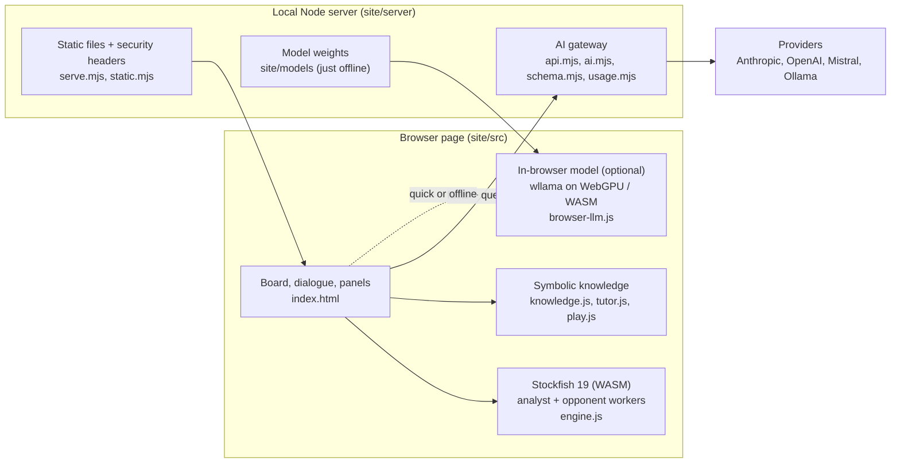

# Architecture

How Kibitz is built, and the ideas behind it. The plan is in [TODO.md](TODO.md), ideas beyond it in [ROAD.md](ROAD.md), and what was built, with its trade-offs, in [DONE.md](DONE.md). For a gentler introduction, from how a language model works to running such a system responsibly, see the [primer](Primer_v01.pdf); the [flipbook](flipbook/README.md) shows the app at work. Items that are planned but not built yet are marked with their TODO number.

## Motivation

The Kibitz repo uses a modern chess training app to demonstrate key concepts in LLM-based and neurosymbolic architecture. Chess suits this well:

- **There is a ground truth.** Stockfish plays far above any human and its analysis can be checked, so every claim a language model makes can be measured against it. Where most domains have to trust the model or ask an expert, here a wrong move is visible at once.
- **Calculation and explanation are different skills.** The engine is exact and silent, and the model is fluent but bad at calculating. The app needs both, which makes the division of labour between a symbolic and a neural system concrete instead of abstract.
- **The patterns are the ones production systems need.** Context control, retrieval, structured output, tool use, verification and agency under policy (section 3) all appear here, at a scale one person can read and run. The same shape fits other domains where a system of record knows the facts and a model explains them.
- **It runs on one machine.** The engine, and even a small language model, run in the browser, so the whole architecture can be studied without cloud accounts or keys (section 4).

## 1. The idea: a symbolic engine and a neural explainer

Kibitz is a neurosymbolic chess coach. Two very different kinds of system work together, and each does only what it's good at.

- **The symbolic side calculates and checks.**
  - Stockfish searches the position. Its evaluation is a small neural network (NNUE), but the search, the rules and everything built on them are exact.
  - chess.js knows the rules.
  - `knowledge.js` detects motifs (fork, pin, discovered attack, back rank, ...), pawn structures and position themes, and classifies moves by how much they change the winning chances.
  - All of this is deterministic and can be tested, and it is right about concrete play.
- **The neural side explains.** A language model (Claude, OpenAI, Mistral, Ollama, or a small model running in the browser) turns those facts into language a player at a given level can use: ideas, plans, what to watch for. It is good at language and teaching, and unreliable at calculating variations.
- **The symbolic side has the last word.** The model only sees facts the engine produced, it is told to take every line from them, and its answer is checked against them afterwards (section 3.6). Moves it makes up are struck through for the player.

This split is also the user experience:

- **The numbers come from the engine.** Evaluations, best moves, mistakes and the review are Stockfish's, shown directly: the eval bar, the flags, the review graph. The coach adds the "why".
- **Help is a dial.** In a running game, the player decides how much the engine may reveal (help Off, Flag mistakes, Eval + mistakes, Full). The coach's view follows that setting, so asking it can't spoil the game (section 3.1).
- **Trust is visible.** Moves the coach names are highlighted when they're backed by Stockfish's lines or the game, greyed when they're legal but unchecked, and struck through when they're wrong.
- **The coach is optional.** Without any language model, play, analysis, flags, review, library and reading suggestions all still work.

## 2. Where things run

- **The page** is a single HTML file plus plain ES modules, with no framework and no bundler. Stockfish runs in Web Workers. When the page is cross-origin isolated (COOP and COEP headers), the analyst uses the multi-threaded build.
- **The local server** serves the page with a strict Content Security Policy. It mounts the AI gateway under `/api/ai/`, which holds the API keys (from `.env`), talks to the providers, enforces limits, and streams answers back as NDJSON. Keys never reach the page.
- **Two other deployments** use the same page:
  - **As a Claude artifact,** where the page uses the host's `window.claude` model instead of the gateway.
  - **Fully offline** (`just offline`), where a small model runs in the page and nothing leaves the machine (section 4).

## 3. Generative-AI patterns, as built here

Kibitz is also a working example of common patterns for building with language models. Each one below says where it lives in the code.

### 3.1 Context control

What the model sees is assembled on purpose, not dumped in.

- **A grounded context per request.** `contextFor()` in the page builds it:
  - the player's level and the game;
  - the moves so far;
  - the position as FEN and as a board diagram;
  - Stockfish's top lines in SAN, with scores;
  - the motifs in the best move;
  - the last move's rating and the engine's alternative;
  - the position themes;
  - board facts such as loose pieces and king shelter (`safetyNotes()`);
  - retrieved references (section 3.2).
- **Shared rules** (`COACH_RULES` in `tutor.js`):
  - take every move and line from the engine lines or the game, at most six plies;
  - explain ideas, not variations;
  - describe evaluations in words;
  - recommend only the references provided;
  - stay short.
- **Context that follows the game state.** `engineView()` decides what the model may see during a game:
  - **everything,** when the game is over, in analysis, or with help Full;
  - **only how the player's own moves rated,** with help Flag mistakes or Eval + mistakes;
  - **no engine data at all,** with help Off.

  This is enforced where the context is built, not by asking the model to keep a secret.
- **Templates per intent** (`tutor.js`). The player picks aspects (last move, what's next, keep in mind, good habits, similar games). Each becomes a fixed instruction, in a fixed order, under a word limit (`commentRequest()`).
- **Untrusted text is quoted.** PGN headers and comments, and the player's own notes, go into prompts only through `quote()` (`prompt.js`): one line, in «guillemets», with control characters removed and a length cap. A standing rule tells the model to treat quoted text as data. This is the defence against indirect prompt injection (OWASP LLM01).
- **Cost and speed:**
  - a model per task: quick questions, chat, reviews;
  - a daily token budget for the server, budgets in tokens and dollars per user for paid models (users told apart by a cookie until there are accounts), and a per-minute rate limit in the gateway;
  - the tokens and cost of every answer, and the player's total today, shown in the dialogue;
  - a cache of coach comments keyed by position, move, aspects, engine view, level and model (`commentKey()`, `lruCache()`).

### 3.2 Retrieval (RAG)

The coach recommends reading and recalls games, but only from what retrieval found.

- **Literature retrieval** (`retrieveLiterature()` in `knowledge.js`). A catalog of books holds metadata and theme tags, not book text. The catalog and the player's own references are ranked by overlap with the position's themes and closeness to the player's level. The top hits go into the context, with the matching part of each book where known. The rules say: recommend only from these.
- **"Seen before"** (`buildPositionIndex()`, `similarPositions()`). Every game in the player's library is indexed by position. The current position is looked up there, and the matches, with the notes made in those games, go into the context and the "Similar games" aspect.

### 3.3 Structured retrieval

Chess positions have structure that text embeddings would blur, so retrieval here uses keys from chess itself rather than vector similarity:

- **The exact position:** the EPD, a FEN without move counters, so transpositions match.
- **The pawn structure:** `pawnSignature()`, so a game with the same structure is found even when the pieces stand elsewhere.
- **Theme tags** from the detectors (IQP, Carlsbad, opposite castling, passed pawn, bishop pair, ...), which connect positions to books and lessons.
- **Engine evaluations** are stored by EPD, from White's point of view, and shared by the board, the review and the coach.

Planned: material and piece-placement signatures, fuzzy pawn-structure distance, and text embeddings for annotations and lesson text, combined with the structural keys in a hybrid ranking (8.1–8.5).

### 3.4 Structured output

For answers the page must act on, such as arrows and highlighted squares on the board, the model returns JSON instead of prose.

- **Named formats only.** The page asks for a format by name (`/api/ai/structured`, `FORMATS` in `schema.mjs`) and can't send a schema of its own.
- **Native first, then a fallback.** The gateway asks each provider for native JSON-schema output. If the provider rejects that, or the reply doesn't fit, it repeats the request with the schema in the instructions and parses the JSON out of the text (`completeJson()`).
- **Validated twice.** The gateway validates every reply against the schema (`validate()`), including limits that strict provider modes can't express (lengths, patterns, item counts). The page checks every square against the position before drawing it (4.4).

### 3.5 Tool use

Instead of receiving a fixed context, the model asks the symbolic side questions (4.11, 4.8.3, 4.10.3):

- **Engine tools:** `analyse`, `try_move` (compare a move with the best), `threats` (what the opponent would do if it were their move), `compare`, `find_mate`.
- **Pattern tools:** `find_motifs` over a line. The same verifier checks patterns in analysis and threat lines: before/after evaluations must lose no more than half a pawn against the best, with a payoff within six plies (material, mate or an advantage that persists at the horizon). Only confirmed motifs are returned. Combination labels also require the engine's reply and follow-up to match. A shared EPD cache, at most twelve additional searches, and a fifteen-second admission budget bound the checks; unresolved patterns stay unverified. A supplied legal line is never evidence by itself.
- **Library tools:** search saved and classic games, search named openings, and load a game at a move, a FEN, a PGN or an opening line.
- **Board tools:** make a move, navigate, set up pieces, and undo a board change. In analysis, moves and setups use the scratch board.

The page checks each call before it runs:

- tool arguments are untrusted, so every FEN and move is checked with chess.js, and depth, time and line count are capped;
- every line the model quotes must come from a tool result;
- tools only load and show, never change or delete saved data;
- leaving a game in progress needs the player's confirmation.

The loop runs in the page, capped at four rounds and six calls per answer. A load analyses its new position before asking the model to explain it. The in-browser model and models that reject tools use fixed context; local commands such as `play e4`, `open the Opera Game`, `remove the queens` and `undo` work without tool support or an AI provider.

The chat's Discuss control selects the current position or general chess. General questions keep their own history and send no board context. Each answer keeps a snapshot of the game and move it was about, with a button to revisit it in analysis. Leaving a running game keeps it in memory with a way back, including its clock; loads and scratch changes never write the saved library.

Play and Study group the task tabs. Entering Review from a live game requires confirmation and pauses its snapshot; returning keeps the study's cursor and results so either session can be revisited. The board, dialogue and review identify their game and move. These paired sessions live in memory. On narrow screens the composer temporarily fits beside the board inside the visual viewport, following keyboard resizing; sending or choosing Full layout restores the normal arrangement.

### 3.6 Verification and guardrails

The model's output is untrusted.

- **Never HTML.** The page renders answers as text, with a minimal markdown subset built from DOM nodes.
- **The answer check** (`checkAnswer()` in `tutor.js`) sorts every move-like token in an answer:
  - in Stockfish's lines, for the position or the one before;
  - one of the game's moves;
  - legal but unchecked;
  - invalid;
  - a bare square.

  Moves joined only by move numbers must form a contiguous run of an engine line or the game. Claims like "the bishop on b5" are checked against the board. Invalid moves are struck through, and a note counts the wrong claims.
- **Stale answers are dropped.** Every async step (engine, coach, review) checks that the game is still the one it started for (`S.gen`, the node, or the FEN) before showing anything.
- **Limits** on input size, request rate and daily tokens, enforced in the gateway.

### 3.7 Agency (planned)

The bounded chat tool loop above is implemented. Longer autonomous investigations across several games remain planned.

The coach as an agent: it decides which tools to call, in a bounded loop, to answer a question like "why did I lose this game?" or "find where I went wrong in my last three losses" (4.8, 4.11). It would:

- load the games;
- run the engine on the critical moments;
- look up the patterns and the matching literature;
- explain what it found.

Bounds:

- a cap on tool calls and engine time per answer;
- read-only tools by default;
- confirmation before anything leaves the current game;
- every claim traceable to a tool result, which the chat can show as evidence.

## 4. A language model in the browser

Offline mode (`just offline`, TODO 2.16) runs the coach's language model inside the page.

- **Runtime.** [wllama](https://github.com/ngxson/wllama) (llama.cpp compiled to WebAssembly) runs a GGUF model on the GPU through WebGPU, or on the CPU with multi-threaded WebAssembly where there's no WebGPU. One MIT-licensed module and one wasm file are copied into `dist/` and imported only when the model is first needed.
- **Models.** A small catalog (`server/models.mjs`) pins each model by size and SHA-256: Qwen2.5 1.5B Instruct by default, 0.5B as a lighter option, both Apache-2.0. `scripts/fetch-model.mjs` downloads one once into `site/models/`, and the local server hands it to the page. The page never fetches weights from another host.
- **Consent and resources:**
  - Nothing loads until the player presses Load, with the size shown.
  - The device memory is checked first.
  - The weights are cached in the browser's storage (OPFS) when there's room. When there isn't, as in a private window, the page fetches them itself and hands them over in memory.
  - The model unloads after ten idle minutes.
- **Sharing the machine.** On the CPU, the model and Stockfish compete for cores: while the model generates, the analyst runs with fewer threads, applied between searches. On WebGPU the CPU is left to Stockfish.
- **Same interface.** `browser-llm.js` exposes the same `sample()` call as the gateway client: streaming, cancellation, JSON-schema output. So the coach code doesn't care where the model runs. A setting can send only the quick requests (chips, automatic comments) to the in-browser model and everything else to a cloud provider.
- **Offline guarantee.** In offline mode the server loads no `.env` and turns on local-only mode. It serves the page without Google Fonts and with a CSP that allows no other host: nothing leaves the machine.
- **What it's good for.** A 1–2 billion parameter model is weak at chess judgement but adequate for putting the engine's facts into words. That is why the neurosymbolic split matters most here: the smaller the model, the more the engine and the answer check carry.

## 5. Security in brief

- **Keys stay on the server.** They are read from `.env` and used only by the gateway. They never appear in responses, logs or the page. The status endpoint names providers and models only.
- **The gateway only serves its own page.** It accepts JSON only from its own origin (against CSRF), only under a local host name (against DNS rebinding), and only up to a size limit. The Ollama base URL is checked against an allowlist (against SSRF).
- **Page hardening:**
  - a hash-based CSP: inline scripts by hash only, no plugins, no framing, `base-uri 'none'`, and `connect-src 'self'`;
  - cross-origin isolation;
  - no dot-files served.
- **Untrusted input everywhere it enters:**
  - imported PGN, model output and library text are never rendered as HTML;
  - every move and square from them is checked with chess.js;
  - every prompt quotes them.
- **Release gate:** before each release, the OWASP Top 10, the OWASP Top 10 for LLM Applications and ASVS checks (TODO 11).

## 6. Testing the parts

- **Unit tests** (`node:test`) cover the symbolic modules and the gateway:
  - motifs, features, classification;
  - the tutor logic and the answer check;
  - clocks and game-end rules;
  - the gateway's validation, limits and providers.
- **No test calls a real provider.**
  - The gateway tests use fake SDK clients and a mock provider.
  - Contract tests replay recorded provider responses through the real SDKs.
  - The page tests run against the mock provider, and the in-browser model is replaced by a fake runtime.
- **Live tests** with real providers or the real in-browser model run only when an environment flag is set (`KIBITZ_LIVE_AI=1`, `KIBITZ_LIVE_MODEL=1`).
- **Playwright** drives the built page in Chrome: full games, the engine fallbacks, the coach, the layout, and a regression test for every fixed bug.
- **Planned:** a tutor eval set scores the coach's answers on reference positions per provider, with engine checks plus a model as judge (3.8).
