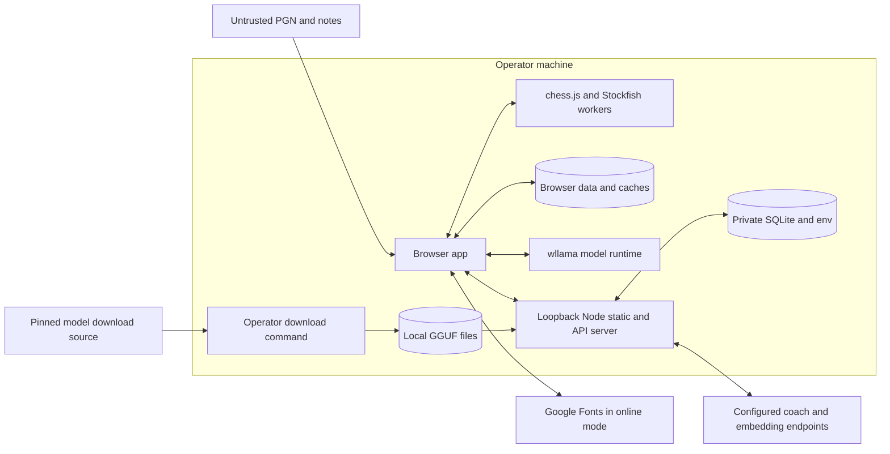

# Threat model: local single-user Kibitz

TODO 11.1. Scope: the standalone browser app and loopback Node server selected in [the deployment decision](DEPLOYMENT.md). This describes implemented boundaries and their limits. The OWASP/ASVS verification and release decision remain separate work under TODO 11.2–11.6.

## Deployment and trust assumptions

One operator controls the installation, `.env`, dependency lockfile, build output, model directory and private databases. The default listener is `127.0.0.1`. Other websites, imported material, model responses and provider endpoints are outside the application's trust boundary. A process that controls the operator's OS account or application files can bypass application controls; private file modes do not provide encryption or protection from that account.

Anonymous cookies group local browser activity. They do not establish a signed-in identity or a hosted tenant-security boundary. `kibitz_uid` groups AI usage; the independent `kibitz_library` token selects an optional server collection. Clearing a cookie creates another scope. Public/LAN hosting, shared accounts and cross-device authentication require a new deployment/security review, rather than changing only `--host`.

“Local app” describes the application deployment. An opted-in cloud coach sends selected content outside the machine. An allowlisted Ollama endpoint can also be operator-configured on another machine. `--offline` removes remote fonts and restricts the page's connections; local-only provider policy is a separate control. The optional artifact host has its own storage/provider contract and is outside the standalone server's guarantees.

## Data flows and boundaries

Arrows show data exchange, rather than authorization. In particular, a model response does not grant permission to save a game, use an arbitrary tool, navigate to an arbitrary URL or read a filesystem path.

| Flow | Data and destination | Boundary and implementation |
| --- | --- | --- |
| Play and analysis | FEN/history, legal moves and engine lines stay in the browser/engine workers. | Rules validate moves; bounded engine tasks return evidence. [Engine](../site/src/chess/engine.js), [coach tools](../site/src/coach/tools.js). |
| Import and browser library | PGN headers, comments, references, profile goals and review/practice records enter browser storage. | External text remains untrusted even after saving. [Library model](../site/src/library/library.js), [storage](../site/src/library/storage.js), [data controls](DATA.md). |
| Optional server library | Cookie-selected games/references cross same-origin JSON routes into private SQLite. | Body scopes are preconditions; the cookie selects the collection. Revision checks and erase tombstones fence stale writes. [API](../site/server/library-api.mjs), [store](../site/server/library-store.mjs). |
| Retrieval and citations | Exact positions, metadata and literal source excerpts feed local search and bounded coach context. | Source hashes/locators bind a citation to the supplied document occurrence; they do not certify its prose or licence claims. [Retrieval context](../site/src/coach/retrieval-context.js), [citation behavior](RETRIEVAL-CITATIONS.md). |
| Coach and connection tests | Questions/history, selected game/position, engine/tool evidence, retrieved excerpts and profile fields go through Node to the configured endpoint. | Separate provider/purpose permission, actual-route checks, request validation and limits precede model work. Keys stay in Node. [Privacy contract](PRIVACY.md), [gateway](../site/server/api.mjs). |
| Embeddings | Explicitly selected passages and queries go to the configured embedding provider. | Permission is distinct from coaching. Vectors remain in browser memory; owner/config/source/policy changes invalidate them. [Embedding gateway](../site/server/embeddings.mjs), [dense index](../site/src/library/dense-search.js). |
| Browser model | Same-origin GGUF weights and coach context enter wllama; inference runs locally. | Download/loading consent, configured model metadata, memory checks, cancellation and idle unloading apply. [Browser model](../site/src/coach/browser-llm.js), [model catalogue](../site/server/models.mjs). |
| Public offline copy | Build-selected app assets enter a versioned service-worker cache. | Installation verifies exact sizes/digests; API responses, weights and private records are excluded. Updates wait for old tabs to close. [Offline worker](../site/src/platform/offline-worker.js), [offline limits](OFFLINE.md). |
| Operational counters | Daily totals and bounded recent admission timestamps enter separate private SQLite under hashed cookie IDs. | Server/user writes are transactional; counters are excluded from chess-data erasure and contain no prompts/answers/keys. [Usage lifecycle](USAGE.md), [store](../site/server/usage-store.mjs). |
| Export and external resources | Browser/library exports download to the operator's device. Online fonts carry ordinary connection metadata to Google. The explicit model-download command contacts the pinned upstream source. | Exports can contain personal text; the operator manages downloaded copies/backups. Font removal, model download and provider permission are independent paths. [Privacy](PRIVACY.md), [download command](../site/scripts/fetch-model.mjs). |

## Assets and privileges

The protected assets are operator API credentials, private chess/profile text, collection boundaries, game/clock integrity, engine/source evidence, saved progress and the operator's money/CPU/storage. Availability matters because model inference and Stockfish share a device.

The model receives explanatory context and a fixed catalogue of bounded tools. It does not receive API keys, filesystem access, shell commands or authority to edit the saved library. Board tools can change a temporary study; leaving a running game requires confirmation, and resulting moves/positions still pass deterministic checks. Tool output is evidence for the supplied position, rather than a general grant of trust.

A provenance hash identifies source content, without proving that the source is true or authorized. A chess.js-legal line is not automatically an engine-backed line. The coach's unrestricted prose remains fallible even when its recognized moves and selected claims pass checks.

## Attack scenarios and existing evidence

| Threat | Existing controls and verification | Residual risk / follow-up |
| --- | --- | --- |
| A foreign website spends provider credits or triggers local writes. | Host/origin/JSON guards; no permissive cross-origin API; provider/purpose attestation before admission. [Gateway tests](../site/server/api.test.mjs), [privacy tests](../site/server/privacy.test.mjs), [library API tests](../site/server/library-api.test.mjs). | Non-browser local clients can omit Origin and attest consent. These controls are not authentication. A same-origin script compromise acts with the page's privileges. |
| PGN, notes or model text inject HTML or instructions. | Literal/escaped rendering, bounded parsers, `quote()` and the untrusted-data rule; hostile annotation and import tests. [Prompt boundary](../site/src/coach/prompt.js), [annotation validation](../site/src/coach/annotations.js), [browser regressions](../site/tests/e2e/regressions.spec.mjs). | Quoting is an instruction/data distinction, not a proof that a model will ignore malicious text. Deterministic action and output checks remain necessary. |
| A model invents a move, source or destructive action. | chess.js legality, captured engine evidence, supplied citation allowlists, fixed tools and per-turn engine/call/time caps. [Annotations](../site/src/coach/annotations.js), [tools](../site/src/coach/coach-tools.js), [browser tool tests](../site/tests/e2e/tools.spec.mjs). | A displayed citation does not prove the accompanying explanation. Unverified prose is advisory; the engine/rules boundary must remain independent of model confidence. |
| A stale answer, source action or storage response crosses into another game/owner. | Generation/FEN/source-revision checks, captured conversation context, owner-scoped caches and optimistic write revisions. [Library storage tests](../site/tests/e2e/library-storage.spec.mjs), [retrieval tests](../site/tests/e2e/retrieval-citations.spec.mjs). | Browser localStorage has no multi-tab transaction. Unknown schemas, failures and uncertain acknowledgements preserve data or require an explicit retry; offline server writes are not queued. |
| Imported or poisoned text dominates retrieval or leaks another scope. | User/library/config fingerprints, bounded passage selection, source/citation validation, vector invalidation and separate embedding consent. [Dense tests](../site/tests/e2e/dense-search.spec.mjs), [hybrid tests](../site/tests/e2e/hybrid-search.spec.mjs). | Ranking/source identity do not verify truth. Semantic false positives and user-authored misleading notes remain possible; no shared hosted vector tenant store is supported. |
| Requests exhaust paid usage, engine time or storage. | Body/message/output limits, tool caps, timeouts, shared/per-cookie minute rates, persistent daily thresholds and library quotas. [Usage tests](../site/server/usage-store.test.mjs), [real restart test](../site/tests/e2e/usage-limits.spec.mjs). | Cookie quotas are soft. Completed-usage thresholds are not reservations or hard billing caps; concurrent/incomplete work can exceed or under-report them. Browser inference/downloads have separate resource limits. |
| A compromised dependency, download or cached asset executes altered code/data. | Lockfile and action pins, model size/SHA-256 checks during verification, public-bundle digest checks, dependency/secret/code scanning. [Offline build](../site/scripts/build-offline.mjs), [model verification tests](../site/server/models.test.mjs). | Operator-controlled build/model files remain trusted. The model marker is a quick availability check, not a fresh hash of every served/cached byte. Download-stream bounds and filesystem trust need review under 11.2/11.3.3/11.5. |
| Misconfiguration exposes keys or private files. | Loopback default, hidden/static-path checks, private mode/outside-static-root database checks, catalogued model names, public status filtering and error-redaction tests. [Server](../site/scripts/serve.mjs), [private paths](../site/server/private-files.mjs). | Operators must keep databases outside every served root, including any separate model directory, and must not expose a shared/public listener. Additional model-root/path and file-race review belongs to the security checklist. |
| Export, erasure or revocation claims completion too early. | Separate confirmations, scope/revision checks, erase tombstones, cache acknowledgements and explicit partial-failure messages. [Data tests](../site/tests/e2e/data.spec.mjs), [privacy tests](../site/tests/e2e/privacy.spec.mjs). | Already transmitted provider data cannot be recalled. Backups, SQLite remnants, other profiles and operational counters have separate retention; downloads remain with the operator. |
| Logs or errors disclose personal text or miss an incident. | Tests check key redaction and absence of prompts/cookies in normal persistence/CLI output. | Default request-URL/provider-error logging and operator observability still need TODO 12.3/11.2 review. A successful test does not establish that every failure path is free of personal data. |

## Verification and maintenance

This model maps the supported flows and known assumptions. It does not mark the OWASP Top 10, LLM Top 10, ASVS or release checklist complete. Existing code-scanning alerts require triage and evidence under TODO 11.2/11.5; their presence is not automatically proof of an exploitable vulnerability, and a passing feature-level check is not a release audit.

Revisit this document when adding a provider/runtime, tool privilege, upload format, storage location, automatic network call or deployment mode. Hosted accounts, remotely exposed servers, shared vector stores and a future browser-managed model backend require explicit updates to the boundaries above. Release verification must record the exact commit, checks, findings and remaining limitations rather than copying this document as a pass certificate.
