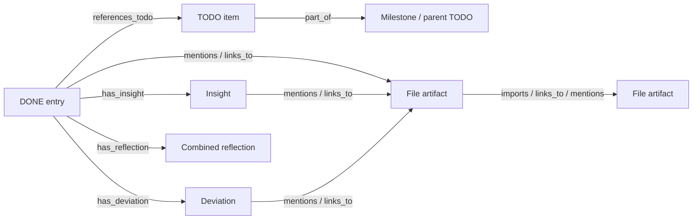

# Assurance lineage report

Generated by `node utils/assure.mjs build`. Counts describe extracted references, not requirement satisfaction or verified evidence.

## Inventory

| Node type | Count |
| --- | ---: |
| artifact | 576 |
| milestone | 13 |
| todo | 229 |
| done | 128 |
| insight | 296 |
| deviation | 214 |
| reflection | 2 |

3938 typed edges; 429 scanned text inputs; 314 unresolved references.

## TODO → DONE index

A DONE reference may describe partial work, deferred scope or a limitation. Checkbox state is copied only from TODO.md.

| TODO | Checkbox | DONE references | Source |
| --- | --- | ---: | --- |
| 0.1: Create the GitHub repo, push `main`, and protect it (PRs required, CI must pass, no force pushes). Note: GitHub offers no branch protection or rulesets for private repos on the Free plan, so PR-only merging is a convention (AGENTS.md) until the repo is public or on Pro. | done | 0 | [docs/TODO.md:21](../../docs/TODO.md) |
| 0.2: Decide the target layout: evolve `claude/` and `codex/` in parallel, or merge them into one app folder. Record the decision in DONE.md. (Merged into `site/`.) | done | 1 | [docs/TODO.md:22](../../docs/TODO.md) |
| 0.3: Set up npm workspaces (`client`, `server`, `shared`) and pin Node LTS (`.nvmrc`, `engines`). Decided against workspaces for now: `site/` stays one npm project (see DONE.md). Node 24 LTS is pinned. | done | 1 | [docs/TODO.md:23](../../docs/TODO.md) |
| 0.4: Decide on typing: JS + JSDoc checked by `tsc --checkJs`, or TypeScript. JS + JSDoc, checked by `npm run typecheck`. | done | 1 | [docs/TODO.md:24](../../docs/TODO.md) |
| 0.5: Add linting and formatting (ESLint, Prettier). ESLint and `.editorconfig`; no Prettier (see DONE.md). | done | 1 | [docs/TODO.md:25](../../docs/TODO.md) |
| 0.6: Set up the test harness: `node:test` for unit tests, `@playwright/test` for e2e (port `claude/tests/e2e.py` to JS) | done | 1 | [docs/TODO.md:26](../../docs/TODO.md) |
| 0.7: Turn `knowledge.test.mjs` into real assertions; today it only prints output | done | 1 | [docs/TODO.md:27](../../docs/TODO.md) |
| 0.8: GitHub Actions on every PR: lint, unit, e2e, build, `npm audit`, CodeQL, secret scanning. CodeQL is skipped while the repo is private; gitleaks does the secret scanning. | done | 2 | [docs/TODO.md:28](../../docs/TODO.md) |
| 0.9: PR template with a checklist: tests, TODO/DONE updated, security impact | done | 1 | [docs/TODO.md:29](../../docs/TODO.md) |
| 0.10: Licensing: GPL-3.0 (required by Stockfish and chessground), `LICENSE` file, third-party notices. GPL-3.0-or-later. | done | 1 | [docs/TODO.md:30](../../docs/TODO.md) |
| 0.11: Fix `.gitignore`: `tests/out/` only matches at the repo root; use `**/tests/out/` | done | 1 | [docs/TODO.md:31](../../docs/TODO.md) |
| 0.12: Keep repository utilities under root `utils/`; move the PDF tooling to `utils/pdf/` and update its references. *(added)* | done | 1 | [docs/TODO.md:32](../../docs/TODO.md) |
| 0.12.1: Rebuild Markdown PDFs only when missing, empty or older than their source/rendering inputs; use modification dates for both `just pdf` and `just pdfs`, retaining agent-instruction exclusions. *(added)* | done | 1 | [docs/TODO.md:33](../../docs/TODO.md) |
| 0.13: Document the LLM and symbolic design across features in a brief design overview, distinguishing built behaviour, planned features and ROAD explorations. *(added)* | done | 1 | [docs/TODO.md:34](../../docs/TODO.md) |
| 0.14: Organize existing source modules into `chess/`, `coach/`, `library/`, `openings/` and `platform/`; preserve directories in the build and update imports, tests, tools and documentation. *(added)* | done | 1 | [docs/TODO.md:35](../../docs/TODO.md) |
| 0.15: Create a typed file-level assurance lineage graph linking artifacts, TODO items, DONE entries, insights and deviations; retain provenance/gaps and provide reproducible validation and queries. *(added)* | done | 1 | [docs/TODO.md:37](../../docs/TODO.md) |
| 0.16: Extend assurance with separate object/PR and documentation/link graphs, reproducible object selection, and a small searchable dependency browser in `utils/`. | done | 1 | [docs/TODO.md:38](../../docs/TODO.md) |
| 0.16.1: Object/function/block lineage and retained PR description sections with explicit provenance. | done | 1 | [docs/TODO.md:39](../../docs/TODO.md) |
| 0.16.2: Documentation headings, fenced blocks, project links and cross-level planning/rationale connections. | done | 1 | [docs/TODO.md:40](../../docs/TODO.md) |
| 0.16.3: Compare compatible graph foundations and implement offline search, traversal and source inspection. | done | 1 | [docs/TODO.md:41](../../docs/TODO.md) |
| 0.17: Add confidence-weighted typed links, editable relation assessments, transparent gap/deviation inference, browser filters and an assurance README. | done | 1 | [docs/TODO.md:42](../../docs/TODO.md) |
| 0.20: Remove native HTTPS (PR #139) from the main development line at the owner's request, preserve its history with the security-drift archive, and verify the restored local HTTP CLI. *(added)* | done | 1 | [docs/TODO.md:43](../../docs/TODO.md) |
| 1.1: Board UI: legal moves, promotion, flip, coordinates *(prototype)* | done | 0 | [docs/TODO.md:47](../../docs/TODO.md) |
| 1.2: Stockfish 19 WASM worker with blob-URL and asm.js fallbacks *(prototype)*; `site/src/chess/engine.js`, unit-tested | done | 0 | [docs/TODO.md:48](../../docs/TODO.md) |
| 1.3: Multi-threaded Stockfish when cross-origin isolated (server sends COOP/COEP headers), with a single-threaded fallback | done | 2 | [docs/TODO.md:49](../../docs/TODO.md) |
| 1.4: Strength levels: `UCI_Elo` from 1320 up, a weakened mode below that *(prototype)*; calibrate them against real ratings. The weakened mode is calibrated against Stockfish's UCI_Elo scale (`scripts/calibrate.mjs`). Remaining: checking the scale against human ratings, which needs players' results (see 9.2). | open | 1 | [docs/TODO.md:50](../../docs/TODO.md) |
| 1.5: Separate analyst engine (full strength, MultiPV) *(prototype)* | done | 1 | [docs/TODO.md:51](../../docs/TODO.md) |
| 1.6: Time controls and clock *(added)* | done | 1 | [docs/TODO.md:52](../../docs/TODO.md) |
| 1.7: Takeback, hint, resign *(prototype)*; draw offers; every game-end rule (threefold repetition, 50-move rule, insufficient material) | done | 1 | [docs/TODO.md:53](../../docs/TODO.md) |
| 1.8: Start from a FEN, an opening, or a curriculum position. FEN and opening done; curriculum positions moved to 6.8, since the curriculum doesn't exist yet. | done | 1 | [docs/TODO.md:54](../../docs/TODO.md) |
| 1.9: PGN import and export with comments and NAGs *(prototype)* | done | 1 | [docs/TODO.md:55](../../docs/TODO.md) |
| 1.10: Post-game review: eval graph, move classes, accuracy *(prototype)* | done | 0 | [docs/TODO.md:56](../../docs/TODO.md) |
| 1.11: Keyboard move entry and screen-reader move announcements *(added)* | done | 1 | [docs/TODO.md:57](../../docs/TODO.md) |
| 1.12: Tests: rule edge cases, engine adapter with a fake worker, e2e for a full game | done | 2 | [docs/TODO.md:58](../../docs/TODO.md) |
| 1.13: Playing style for Stockfish (Solid, Balanced, Active, Aggressive, Reckless), saved with the Elo setting *(added)* | done | 1 | [docs/TODO.md:59](../../docs/TODO.md) |
| 1.14: Help level "Eval + mistakes": mistakes are flagged, and the eval bar shows the position after the player's move, holding it through Stockfish's reply. The best move stays hidden, and the coach sees what it sees with Flag mistakes *(added)* | done | 2 | [docs/TODO.md:60](../../docs/TODO.md) |
| 1.15: Keep the game in progress across reloads in the local app *(added)*. Inside the Claude artifact the host's snapshot (`window.claude.hot`) restores it; the local app (`just serve`) kept nothing. The same snapshot (PGN, cursor, mode, colour, orientation, Elo and style, start ply, clock times) now goes to `localStorage` after every change and when the page goes away, and comes back at boot | done | 2 | [docs/TODO.md:61](../../docs/TODO.md) |
| 2.1: Node server: static hosting, JSON API, security headers (CSP, COOP/COEP, HSTS). HSTS comes once hosted over HTTPS (12.2). | done | 3 | [docs/TODO.md:65](../../docs/TODO.md) |
| 2.2: Provider interface: `chat(messages, {stream, schema, maxTokens, signal})` and `embed(texts)` | done | 1 | [docs/TODO.md:66](../../docs/TODO.md) |
| 2.3: OpenAI adapter | done | 2 | [docs/TODO.md:67](../../docs/TODO.md) |
| 2.4: Mistral adapter | done | 2 | [docs/TODO.md:68](../../docs/TODO.md) |
| 2.5: Claude adapter (Anthropic Messages API) | done | 2 | [docs/TODO.md:69](../../docs/TODO.md) |
| 2.6: Ollama adapter (local models, so nothing leaves the machine) | done | 2 | [docs/TODO.md:70](../../docs/TODO.md) |
| 2.7: Structured output for board annotations on every provider (JSON schema or tool calling, plus fallback parsing) | done | 1 | [docs/TODO.md:71](../../docs/TODO.md) |
| 2.8: Stream replies to the browser (NDJSON over `fetch`), with cancellation | done | 1 | [docs/TODO.md:72](../../docs/TODO.md) |
| 2.9: Key management for the selected local single-user deployment: operator keys come from server env and never reach the browser, logs or prompts. An encrypted per-account store is deferred with hosted accounts; deployment decision | done | 2 | [docs/TODO.md:73](../../docs/TODO.md) |
| 2.10: Model choice per task (quick comment, chat, deep review) and per provider *(added)* | done | 1 | [docs/TODO.md:74](../../docs/TODO.md) |
| 2.10.1: Use GPT-6 Luna's supported non-reasoning mode for Chat Completions, including per-task selection, Stockfish tool continuations, structured replies and the connection check; keep other models/providers unchanged | done | 1 | [docs/TODO.md:75](../../docs/TODO.md) |
| 2.11: Limits for the selected local single-user app: shared and per-cookie minute rates, daily server tokens, per-cookie paid token/cost thresholds, timeouts and usage display. Standard serve recipes persist counters across restarts in private SQLite. Cookies supply soft local grouping; hosted account budgets remain deferred with 10.2. Behavior, retention and admission-threshold limits. | done | 6 | [docs/TODO.md:76](../../docs/TODO.md) |
| 2.12: Allowlist for the Ollama base URL (SSRF guard) *(added)* | done | 2 | [docs/TODO.md:77](../../docs/TODO.md) |
| 2.13: Mock provider with deterministic fixtures for tests and offline development *(added)* | done | 1 | [docs/TODO.md:78](../../docs/TODO.md) |
| 2.14: Settings UI: provider, model, connection test, local-only mode | done | 1 | [docs/TODO.md:79](../../docs/TODO.md) |
| 2.15: Contract tests per adapter against recorded responses; live smoke tests run only when an env flag is set. Remaining: recorded fixtures for OpenAI, Mistral and Ollama (hand-written from the documented format until their keys work; Claude's are recorded). | open | 2 | [docs/TODO.md:80](../../docs/TODO.md) |
| 2.16: Offline mode with an in-browser model: default pinned wllama/GGUF inference plus optional Chrome built-in model, explicit loading consent and offline lifecycle. Initial weight provisioning needs the relevant download; runtime-specific limits *(added)* | done | 1 | [docs/TODO.md:81](../../docs/TODO.md) |
| 2.16.0: `just offline`, a recipe of its own: on first run it downloads the chosen model's weights into `site/models/` (gitignored, checksums verified); then it builds and serves the app with local-only mode on and the in-browser model as the provider. In this mode nothing leaves the machine: the weights come from our own server and the CSP allows `connect-src 'self'` only | done | 1 | [docs/TODO.md:82](../../docs/TODO.md) |
| 2.16.1: Runtime: | done | 2 | [docs/TODO.md:83](../../docs/TODO.md) |
| 2.16.2: Model: a small open model under Apache-2.0 or MIT, chosen with the tutor eval set (3.8). It only puts into words what the engine and the detectors found, which is what makes a small model usable. The weights download on first use, only after the player agrees, with the size shown. They're cached in the browser and always come from our own server (2.16.0), never from a CDN. Done: Qwen2.5 1.5B Instruct (default) and 0.5B, Apache-2.0, pinned by SHA-256, consent before loading. The eval set (3.8) keeps 1.5B as the default: 50% against 42% for 0.5B, but far behind the cloud models (Haiku 79%, Opus 95%), so it stays the offline fallback | done | 2 | [docs/TODO.md:89](../../docs/TODO.md) |
| 2.16.3: wllama runs in its own Worker behind the page-side sample interface; Chrome's current API requires Window access and uses disposable session clones. Both support streaming/cancellation and requested JSON constraints; native Chrome has character/time bounds without invented token usage. Settings list them as "In browser", and local-only mode (2.14) counts them as local | done | 1 | [docs/TODO.md:90](../../docs/TODO.md) |
| 2.16.4: Resources: on the CPU it competes with Stockfish for threads, so the analyst gets fewer threads while the model is generating. Free memory is checked before loading, and the model is unloaded when idle | done | 1 | [docs/TODO.md:91](../../docs/TODO.md) |
| 2.16.5: Routing per task (2.10): quick comments run in the browser, and chat and reviews go to the gateway when one is set up | done | 1 | [docs/TODO.md:92](../../docs/TODO.md) |
| 2.16.6: Tests: the page-side provider against a fake runtime in the Worker, and a live smoke test with a real model only when an env flag is set | done | 1 | [docs/TODO.md:93](../../docs/TODO.md) |
| 3.1: Grounding pipeline: engine lines in SAN, move class, motifs, position features and retrieved references go into the prompt context *(prototype: `contextFor`)* | done | 0 | [docs/TODO.md:97](../../docs/TODO.md) |
| 3.2: Aspect picker: | done | 1 | [docs/TODO.md:98](../../docs/TODO.md) |
| 3.2.1: Last move: what it did, its rating, the engine's alternative | done | 1 | [docs/TODO.md:99](../../docs/TODO.md) |
| 3.2.2: Future moves and opportunities: threats, plans, candidate moves | done | 1 | [docs/TODO.md:100](../../docs/TODO.md) |
| 3.2.3: Things to keep in mind: weaknesses, king safety, loose pieces | done | 1 | [docs/TODO.md:101](../../docs/TODO.md) |
| 3.2.4: Habits of strong players: blunder check, candidate moves, prophylaxis | done | 1 | [docs/TODO.md:102](../../docs/TODO.md) |
| 3.2.5: Relevant classic games, taken from the reference library through RAG. The "Similar games" aspect uses similar positions from the player's library and the classic games that match the position's themes (`classics.js retrieveClassics`), which the Reading tab lists too | done | 2 | [docs/TODO.md:103](../../docs/TODO.md) |
| 3.3: A prompt template per aspect, with shared rules: don't invent variations, back every claim with an engine line | done | 1 | [docs/TODO.md:104](../../docs/TODO.md) |
| 3.4: Validate the output: check every move, square and line against chess.js and the engine's lines, then drop or flag the ones that can't be verified *(added)*. Flagged, not dropped (see DONE.md) | done | 2 | [docs/TODO.md:105](../../docs/TODO.md) |
| 3.5: Adapt to the player's level *(prototype)* | done | 0 | [docs/TODO.md:106](../../docs/TODO.md) |
| 3.6: When to comment: after every move, only after mistakes, or on request; no spoilers mid-game unless help is on | done | 1 | [docs/TODO.md:107](../../docs/TODO.md) |
| 3.7: Cache comments by position, ordered game/scratch history, aspects, help view, level, model and language. Equal EPDs at different game steps do not share numbered commentary | done | 2 | [docs/TODO.md:108](../../docs/TODO.md) |
| 3.8: Tutor eval set: reference positions with the key points a good comment should hit; scored by engine checks plus an LLM judge, run per provider *(added)* | done | 2 | [docs/TODO.md:109](../../docs/TODO.md) |
| 3.9: Explanation modes, chosen in the coach settings and switchable at any time *(added)*. In the Coach tab as "How the coach works": Only when asked, After my mistakes, After my moves, Commentary on every move, Challenge me | done | 1 | [docs/TODO.md:110](../../docs/TODO.md) |
| 3.9.1: On request (today's behaviour): the coach speaks when asked or when a chip is clicked | done | 1 | [docs/TODO.md:111](../../docs/TODO.md) |
| 3.9.2: Continuous commentary: a short comment on every move by either side, like a broadcast commentator. Uses the quick model, is cached per position (3.7), and keeps to the spoiler rules from 3.6 during a game | done | 1 | [docs/TODO.md:112](../../docs/TODO.md) |
| 3.9.3: Challenges: the coach asks instead of explaining ("What does Black threaten?", "Find the best move", "Nf3 or Bg5?", "Which square is weak?"). The player's answer is checked against the engine and the motif detectors before the coach reveals anything, and results count toward progress per theme (6.7, 9.2). Done: best move, the better of two, and the threat (the position with the other side to move); results per theme are kept in the browser and shown in the Coach tab, for 6.7 and 9.2 to build on | done | 1 | [docs/TODO.md:113](../../docs/TODO.md) |
| 3.9.4: Interesting moves, not only the best: the analyst's MultiPV count and a centipawn window become settings. From the moves inside the window, the coach picks the ones worth showing (a different plan, a sacrifice, a quiet move, a trap for the opponent) instead of always the engine's first line. Each pick shows its engine rank and evaluation | done | 1 | [docs/TODO.md:114](../../docs/TODO.md) |
| 3.9.5: Tests: each mode with the mock provider, challenge answers checked against fixed engine lines, the move picker on reference positions | done | 1 | [docs/TODO.md:115](../../docs/TODO.md) |
| 4.1: Chat panel: history per game and position, streaming, stop button *(prototype)* | done | 0 | [docs/TODO.md:119](../../docs/TODO.md) |
| 4.2: Annotation schema: arrows, square highlights, ghost pieces, labels, move sequences | done | 1 | [docs/TODO.md:120](../../docs/TODO.md) |
| 4.3: Rendering: chessground shapes for arrows and highlights; a ghost-piece layer; a variation stepper that leaves the game untouched. Commentary links use captured game/evidence positions and explicit move numbers, including historical occurrences and alternatives | done | 2 | [docs/TODO.md:121](../../docs/TODO.md) |
| 4.4: Check every annotation against the current position before drawing it | done | 1 | [docs/TODO.md:122](../../docs/TODO.md) |
| 4.5: "What if": the user tries a move on a scratch board, the engine evaluates it, the tutor explains | done | 1 | [docs/TODO.md:123](../../docs/TODO.md) |
| 4.6: Chat context: current position, game so far, selected aspects, recent tutor comments | done | 3 | [docs/TODO.md:124](../../docs/TODO.md) |
| 4.7: Tests: schema validation, rendering e2e, malformed and hostile model output | done | 2 | [docs/TODO.md:125](../../docs/TODO.md) |
| 4.8: Free conversation with the coach, about any game or position, not only the one on the board *(added)* | done | 1 | [docs/TODO.md:126](../../docs/TODO.md) |
| 4.8.1: Open questions (plans, openings, general chess) without a position; answers stay grounded in the engine whenever a position is involved | done | 0 | [docs/TODO.md:127](../../docs/TODO.md) |
| 4.8.2: Load from the chat: the player names a game ("the Opera Game", "my last loss with Black") or pastes a FEN or PGN, and the coach puts it on the board in analysis mode | done | 0 | [docs/TODO.md:128](../../docs/TODO.md) |
| 4.8.3: Coach tools: search the library (7.5), load a game at a given move, load a position, load an opening line. Every load is checked with chess.js, and leaving a game in progress needs the player's confirmation; the tools only load, never change or delete anything (11.3.6). Builds on tool calling (2.7) | done | 0 | [docs/TODO.md:129](../../docs/TODO.md) |
| 4.8.4: After a load, the engine analyses the position before the coach explains it, and the chat keeps track of which game and move each answer refers to | done | 0 | [docs/TODO.md:130](../../docs/TODO.md) |
| 4.8.5: Tests: tool calls with the mock provider, invalid or hostile load requests, confirmation before leaving a game | done | 0 | [docs/TODO.md:131](../../docs/TODO.md) |
| 4.9: One chat outside the tabs: the chat stays visible whichever tab is open (play, analysis, review, openings, lessons), instead of living inside the Coach tab *(added)* | done | 1 | [docs/TODO.md:132](../../docs/TODO.md) |
| 4.9.1: The chat follows the context. By default the coach talks about the active tab's game and position. A message that names something else ("this opening", "my last game", a FEN) switches the context, which shows as a chip above the input that the player can change. Each answer stays tied to the game and move it was about | done | 0 | [docs/TODO.md:133](../../docs/TODO.md) |
| 4.9.2: Layout: a side panel on wide screens and a drawer on mobile (10.6), collapsible, with the history kept across tab switches. Done as the dialogue beside the board, as tall as it; the tab panels below fold away. On a phone it follows the board with a capped height, not a drawer | done | 1 | [docs/TODO.md:134](../../docs/TODO.md) |
| 4.9.3: Tests: e2e for the chat across tabs, switching context by tab and by message, the mobile drawer. Covered by `layout.spec` and `chat.spec`: tab switches, general/position context, answer links, phone portrait and landscape, and tablet widths. The mobile layout remains the capped dialogue from 4.9.2 | done | 1 | [docs/TODO.md:135](../../docs/TODO.md) |
| 4.10: Board control from the chat: the chat can make moves and set up pieces *(added)* | done | 1 | [docs/TODO.md:136](../../docs/TODO.md) |
| 4.10.1: Moves: "play e4", "take back two moves", "go to move 15", "show me Nxf7 and what follows". Plain move text goes through the typed-move parser (`parseMoveInput`) without calling the model. In a game, the chat moves only for the player and follows the clock and help settings; elsewhere it plays in analysis, on a variation that leaves the game untouched (4.3) | done | 0 | [docs/TODO.md:137](../../docs/TODO.md) |
| 4.10.2: Setup: "put a white knight on f5", "remove the queens", "set up a Lucena position", "White to move". This edits a scratch board in analysis mode, never a game in progress. The result must be a legal position (`checkStart`, `fixCastling`) before it's shown, with the side to move and castling rights stated | done | 0 | [docs/TODO.md:138](../../docs/TODO.md) |
| 4.10.3: Coach tools for both (with 4.8.3): `move`, `goto`, `setup` taking pieces and squares, `undo`. Every call is checked with chess.js, every board change can be undone in one step, and none of them touches saved games or the library | done | 0 | [docs/TODO.md:139](../../docs/TODO.md) |
| 4.10.4: After each change the engine re-analyses, and the coach's next answer is about the new position (async results checked against the FEN) | done | 0 | [docs/TODO.md:140](../../docs/TODO.md) |
| 4.10.5: Tests: moves and setups through the mock provider, illegal or hostile requests (impossible positions, moves for the engine's side, setup during a game), undo | done | 0 | [docs/TODO.md:141](../../docs/TODO.md) |
| 4.11: Engine tools for the coach: the model asks, and Stockfish and the motif detectors answer *(added)* | done | 1 | [docs/TODO.md:142](../../docs/TODO.md) |
| 4.11.1: Tools: | done | 1 | [docs/TODO.md:143](../../docs/TODO.md) |
| 4.11.2: Pattern search over lines: detectors inspect every move, with before/after engine evaluations and a short best-reply continuation confirming material gain, mate or sustained positional compensation. Unverified and refuted patterns are withheld. Candidate detectors cover the tactical themes in 6.2, including skewers, double checks, deflection, decoy, overloading, interference, removing a defender and checking zwischenzugs. A 1.5-pawn gap flags an "only move" when the best move still holds. Checks share an EPD cache and a search/time budget; see DONE.md for the conservative limits | done | 3 | [docs/TODO.md:150](../../docs/TODO.md) |
| 4.11.3: Native tool calling in the gateway: Claude tool use, and function calling for OpenAI, Mistral and Ollama. One mechanism also serves load tools (4.8.3) and board tools (4.10.3). Only an explicit unsupported-tool rejection enables fixed-context fallback, scoped to the actual provider/model for that task and shown in the answer. Temporary or unrelated provider errors preserve tool access. A successful connection test retries support for that model | done | 2 | [docs/TODO.md:151](../../docs/TODO.md) |
| 4.11.4: Where the engine runs: in the page, with the gateway handing each tool call to the page and waiting for the result, or on the server, where the npm Stockfish build also runs in Node. Decide on latency, cost and hosted load (10.1). Each answer gets a cap on tool calls and engine time. Decided: in the page. The page asks the gateway for one model turn at a time and runs each tool call on its own Stockfish | done | 1 | [docs/TODO.md:152](../../docs/TODO.md) |
| 4.11.5: Tool arguments are untrusted: FENs and moves are checked with chess.js, and depth, time and line count are capped. Every line the model quotes must come from a tool result (3.4). The tool results are kept with the answer, so the chat can show the evidence | done | 1 | [docs/TODO.md:153](../../docs/TODO.md) |
| 4.11.6: Tests: tool loops with the mock provider and a fake engine; hostile arguments (illegal FEN, huge depth, a tool loop that doesn't end); contract fixtures per provider; transient failures, unrelated rejections, quick/chat model isolation, model-change/reconnection recovery, a translated fallback notice and live-help explanations with Full-help recovery in the same conversation | done | 2 | [docs/TODO.md:154](../../docs/TODO.md) |
| 4.12: UX review *(added)* | done | 1 | [docs/TODO.md:155](../../docs/TODO.md) |
| 4.12.1: Settings behind a gear icon in the header, opening an overlay (a modal dialog: Escape and a click outside close it, focus stays inside while it is open). It takes what is spread over the tabs today: the coach settings and provider, local-only mode, the engine depth, the player's level, and when the coach comments. The tabs keep only what belongs to their task | done | 1 | [docs/TODO.md:156](../../docs/TODO.md) |
| 4.12.2: The dialogue stays beside the board on desktop, tablets and phone landscape, and below it on phone portrait. While composing on a narrow screen, a temporary layout fits the board beside the composer in the visual viewport, including keyboard resizing. Full layout, Escape or sending restores the normal view. Covered at portrait, landscape and tablet sizes, with reduced viewports simulating the keyboard | done | 1 | [docs/TODO.md:157](../../docs/TODO.md) |
| 4.12.3: Play (Game, Coach) and Study (Review, Library, Reading) group the tabs. The board, dialogue and review show the game and move. Entering review from a running game requires confirmation and pauses a snapshot, with a Return button; returning keeps the study's cursor and review results for the next visit. PGN/library loads and the Analyse switch also keep a way back. Both sessions are kept in memory, not across a reload | done | 1 | [docs/TODO.md:158](../../docs/TODO.md) |
| 4.12.4: Tests: existing settings, layout and chat suites plus `ux.spec` cover the grouped navigation, explicit review confirmation/cancellation, both sessions surviving a round trip, PGN and Analyse transitions, a stale confirmation after a new game, and board/composer visibility in reduced phone/tablet viewports | done | 1 | [docs/TODO.md:162](../../docs/TODO.md) |
| 4.12.5: A wrong move in an answer is underlined in red instead of struck through, so it stays readable | done | 1 | [docs/TODO.md:159](../../docs/TODO.md) |
| 4.12.6: Game references in answers link to the game: a classic named in the text ("the Opera Game", "Réti–Tartakower", "the Lucena position") shows its key position on the board while hovered or focused, and opens the game there on a click. A first step towards ROAD's "the text points at the board" | done | 1 | [docs/TODO.md:160](../../docs/TODO.md) |
| 4.12.7: Direct game/analysis round trip: Analyse immediately pauses a detached game snapshot and its clock; Play or Return restores the original history, viewed step and result. Analysis branches and review results survive a return while the game checkpoint is unchanged; advancing the game opens fresh analysis. Return controls bypass chat/challenges, and switching cancels stale engine/coach work. Includes untouched/custom-start and finished games; paired sessions remain in memory | done | 1 | [docs/TODO.md:161](../../docs/TODO.md) |
| 5.1: Opening names by position (Lichess chess-openings, CC0), in `site/data/eco` | done | 1 | [docs/TODO.md:166](../../docs/TODO.md) |
| 5.2: Opening explorer: position/move graph from standard-start reference games, with corpus filters, continuation counts, White/draw/Black/unknown results and sample games at the matching ply. Transpositions join; repeated positions count once per record. Continuations use the scratch board and respect live help. Uses the existing classics and saved/imported games; no external explorer API | done | 1 | [docs/TODO.md:167](../../docs/TODO.md) |
| 5.3: Repertoire builder: named White/Black repertoires with editable standard-start lines and notes, capture from the game/scratch board up to the displayed move, position-based chosen moves, confirmed removal and PGN copy. Validated browser-local storage is separate from games; live-help restrictions apply | done | 1 | [docs/TODO.md:168](../../docs/TODO.md) |
| 5.4: Repertoire drill with spaced repetition: browser-local due/new position reviews for White and Black, accepting all saved choices at transpositions, with automatic opponent replies, board/keyboard input, hints/reveal, recall statistics and deterministic review intervals. A separate drill board preserves the game; live-help restrictions apply *(added)* | done | 1 | [docs/TODO.md:169](../../docs/TODO.md) |
| 5.5: Opening explanations: original English/German guides for twelve opening families and seven pawn patterns, covering ideas, typical plans and possible structures. EPD/visible-route matching follows transpositions and scratch branches; current pawn patterns are separate from opening background. Guides display without a provider and enter permitted coach context as quoted study notes; concrete moves still require engine evidence. Live-help restrictions apply | done | 1 | [docs/TODO.md:170](../../docs/TODO.md) |
| 5.6: Opening variations at the board: current opening and legal moves towards named destinations from the CC0 catalogue | done | 0 | [docs/TODO.md:171](../../docs/TODO.md) |
| 5.6.1: Current name/ECO and each next move's three nearest named destinations, compiled from the same lines as `openings.json`. Deeper names show the remaining plies; frequencies stay in the reference-game explorer (5.2) | done | 1 | [docs/TODO.md:172](../../docs/TODO.md) |
| 5.6.2: Hover/focus previews the position after the move. Click/Enter extends a scratch line in analysis; at the current live position it plays a normal player move, with turn/clock/engine-reply guards | done | 1 | [docs/TODO.md:173](../../docs/TODO.md) |
| 5.6.3: EPD matching joins transpositions and preserves side/castling/en-passant rights. SAN and full move numbers come from the query FEN | done | 1 | [docs/TODO.md:174](../../docs/TODO.md) |
| 5.6.4: Restricted live help (off, flags, eval) clears the panel, including while closed. Full help allows browsing; historical/opponent-turn moves cannot be played. Held actions recheck game, position and permission | done | 1 | [docs/TODO.md:175](../../docs/TODO.md) |
| 5.6.5: Permitted coach context includes quoted catalogue metadata alongside 5.5 study notes. "About this opening" asks about the actual displayed position; General chess/restricted help omit names. Concrete advice still requires Stockfish evidence | done | 1 | [docs/TODO.md:176](../../docs/TODO.md) |
| 5.6.6: Unit/browser coverage: known/deeper destinations, transpositions, rights/counters, malformed data, preview/keyboard cleanup, scratch/live actions, stale actions/loading, help policy, coach context and German phone layout | done | 1 | [docs/TODO.md:177](../../docs/TODO.md) |
| 6.1: Curriculum structure: validated modules → lessons → exercises with stable IDs, levels, themes, bilingual authored text, acyclic prerequisites and source/licence metadata. Lessons catalogue filters by level/module/theme; positions and recorded lines are checked with chess.js, including terminal mate checks for mate exercises | done | 1 | [docs/TODO.md:181](../../docs/TODO.md) |
| 6.2: Tactics: 13 bilingual concept lessons covering forks, pins, skewers, discovered attacks, double checks, deflection, decoy, overloading, interference, removing a defender, zwischenzugs, back rank and mating patterns. Legal examples and declared motif geometry are checked; a capturable-fork counterexample distinguishes recognition from payoff | done | 1 | [docs/TODO.md:182](../../docs/TODO.md) |
| 6.3: Strategy: eleven bilingual reflection lessons covering IQP, Carlsbad and hanging-pawn structures, weak squares, outposts, bishop quality, open files, king safety, piece/king activity and prophylaxis. Legal examples, explicit objectives/rubrics, checked structure tags and board-fact tests support the authored material; candidate plans are not engine verdicts | done | 1 | [docs/TODO.md:183](../../docs/TODO.md) |
| 6.4: Endgames: six bilingual lessons cover queen/rook mates for both colours, king and pawn, the rook-pawn exception, opposition with either side to move, Lucena and Philidor. Ten exercises and all 28 worked plies are checked against recorded Syzygy outcomes for full FEN; offline audit and explicit refresh script preserve source/date/digests | done | 1 | [docs/TODO.md:184](../../docs/TODO.md) |
| 6.5: Puzzle source: bounded Lichess CC0 CSV ingestion and 64 recorded starter puzzles, with source IDs/themes/ratings/licence, provenance/digest and offline regeneration. Setup moves are applied before learner positions; all solutions replay legally and mate claims are rules-checked. Four editorial rating groups join the catalogue | done | 1 | [docs/TODO.md:185](../../docs/TODO.md) |
| 6.6: Lesson player: isolated interactive board, explanations, keyboard worked-line viewer, staged authored hints, explicit promotions and reveal/restart. Mate tasks accept every actual checkmate; source puzzles check recorded-line recall and replies; written reflections require rubric self-assessment. Completion events distinguish these outcomes and help use | done | 1 | [docs/TODO.md:186](../../docs/TODO.md) |
| 6.7: Progress per lesson and theme: versioned browser-local results with separate mate/recall/self-assessment/reveal and help counters, retained task revisions, validated Coach challenge counters, catalogue badges, retryable failed saves and preserved unreadable data. Counts describe practice rather than measured mastery; no reflection response text is stored | done | 1 | [docs/TODO.md:187](../../docs/TODO.md) |
| 6.8: Play the displayed lesson position against Stockfish as either colour, preserving its full FEN and using existing strength/clock settings. Active games require a confirmed successful save; cancellation, stale actions and save failures leave the current game intact | done | 2 | [docs/TODO.md:188](../../docs/TODO.md) |
| 7.1: Source-aware data model: stable collection-scoped game/source IDs, shared EPD positions, full-FEN occurrences and revision-bound annotations/studies. Separate score/comment licences, exact mainline PGN locators, optional import/source editing and non-destructive legacy handling; schema and lifecycle | done | 1 | [docs/TODO.md:192](../../docs/TODO.md) |
| 7.2: PGN import with conservative document deduplication: skip repeat copies within a batch/current user library, allowing outside whitespace/header-order differences while preserving distinct annotations, variations, headers, full-FEN starts and source/licence assertions. Separate added/duplicate/unreadable/failed counts, bounded batches and retry-safe local/account writes | done | 1 | [docs/TODO.md:193](../../docs/TODO.md) |
| 7.3: Classic games collection: 21 games, with per-game published score sources/rights and original Kibitz notes. Twelve complete Capablanca book scores join nine sourced teaching versions; 1,355 plies audit offline, including reconstruction of 980 descriptive book plies. Fixed revisions/page links, retained source licences, explicit historical/teaching distinctions and excluded incomplete scores are documented in the source manifest. Problem/study sources are covered in 7.4 | done | 2 | [docs/TODO.md:194](../../docs/TODO.md) |
| 7.4: Problems and studies collection: twelve sourced positions, four actual mates in one and eight studies/reflections. Published Réti/Saavedra diagrams, explicit Lucena/Philidor teaching variants and eight authored curriculum examples have bilingual questions, a Problems filter and diagram-first opening. Exact source/FEN/line bindings check 48 worked plies against 50 saved tablebase records; imports/prose/other branches gain no certificate. Sources, rights and offline audit | done | 2 | [docs/TODO.md:195](../../docs/TODO.md) |
| 7.5: Search by player, opening, recorded year range, result and theme: combined literal case/accent-insensitive metadata filters, localized titles/theme labels, legal PGN/ECO facts, explicit invalid/unknown-year handling and shared coach-tool matching. Accessible English/German controls retain category/reset behavior and source drafts/focus; rules and limits | done | 1 | [docs/TODO.md:196](../../docs/TODO.md) |
| 7.6: Storage: optional private SQLite server library with anonymous cookie scopes, atomic optimistic writes, bounded legal records and a verified-scope IndexedDB cache. Explicit English/German selection keeps browser/account stores separate without uploads or migration; cache failures do not revoke server saves, and conflicts/uncertain receipts require refresh. Storage lifecycle and limits | done | 1 | [docs/TODO.md:197](../../docs/TODO.md) |
| 7.7: The user's own games *(prototype)* | done | 0 | [docs/TODO.md:198](../../docs/TODO.md) |
| 8.1: Position index: exact EPD and pawn signature plus versioned colour-specific material counts, full piece placement and occupied piece-square terms. Rules-replayed source occurrences retain full FEN/revisions; bounded, source-filtered feature lookups distinguish structural matches without changing default retrieval ranking. Fields and limits | done | 3 | [docs/TODO.md:202](../../docs/TODO.md) |
| 8.2: Pattern tags per source position and recorded move/three-ply branch, derived from legal replay with exact occurrence/revision identities. Position heuristics, geometric candidates and rules-proven mate/promotion facts remain distinct. Local English/German pattern search filters evidence/source and opens exact occurrences under live-help/source-generation guards; fields and limits | done | 2 | [docs/TODO.md:203](../../docs/TODO.md) |
| 8.3: Text index for annotations and lesson text; embeddings from a separately configured provider (OpenAI, Mistral or Ollama; Anthropic has no embeddings API) | done | 3 | [docs/TODO.md:204](../../docs/TODO.md) |
| 8.3.1: Local lexical passage index: mainline comments with source/occurrence locators, bilingual authored guide sections, filtered BM25 Library search, exact annotated-position navigation and a 28-query passage benchmark | done | 1 | [docs/TODO.md:205](../../docs/TODO.md) |
| 8.3.2: Explicit semantic indexing/search of selected passages, scoped in-memory vectors, local-only enforcement and provider/model/revision/dimension metadata. Local bge-m3 comparison improves paraphrase recall but exposes uncalibrated no-answer false positives | done | 2 | [docs/TODO.md:206](../../docs/TODO.md) |
| 8.4: Hybrid retrieval: bounded rank fusion of BM25, dense, exact/pawn and feature-tag candidates; deterministic term/board reranking, visible match reasons and optional literal every-term filtering. Measured comparison records recall/no-answer tradeoffs; semantic support and calibrated abstention are not established | done | 3 | [docs/TODO.md:207](../../docs/TODO.md) |
| 8.5: Fuzzy pawn-structure distance: colour-specific square-set Jaccard distance, optional ≥75% overlap in Combined search, compatible turn/check/phase, exact/analogy labels and unmatched-square explanations. Offline spatial comparison records gains and the sparse one-pawn miss | done | 3 | [docs/TODO.md:208](../../docs/TODO.md) |
| 8.6: Retrieved coach passages and citations: bounded local keyword/board retrieval for tutor/chat, quoted source excerpts, request-bound citation IDs, exact occurrence navigation and live-game confirmation/return. Citation identity is checked; semantic support is not automatically verified | done | 1 | [docs/TODO.md:209](../../docs/TODO.md) |
| 8.7: Treat retrieved text as untrusted: delimit it and never follow instructions inside it (imported PGN comments can carry prompt injection) *(added)* | done | 1 | [docs/TODO.md:210](../../docs/TODO.md) |
| 8.8: Retrieval eval: 24 labelled English/German position queries with expected source/occurrence references; offline production baseline with precision/recall/MRR/nDCG at 1/3/6 and separate no-answer false-positive rates. Method and results; literature algorithm comparison distinguishes current measurements from published tasks and proposed replications *(added)* | done | 3 | [docs/TODO.md:211](../../docs/TODO.md) |
| 8.9: Research text, structured and graph RAG, neurosymbolic game approaches, and AI use cases in milestones 5–7; document the current Stockfish boundary and proposed evaluations in docs/research. Research delivery; subsequent implementation is tracked separately above. *(added)* | done | 1 | [docs/TODO.md:212](../../docs/TODO.md) |
| 9.1: Browser-local player profile: explanation level, optional self-reported rating/pool/time control and bounded learning goals. Acknowledged saves, future-format preservation, stale-tab draft protection and quoted request context keep preferences separate from measured ability/opponent strength; lifecycle and limits | done | 1 | [docs/TODO.md:216](../../docs/TODO.md) |
| 9.2: Own-game review trends: source-bound historical analysis reports, measured-move/error/accuracy coverage by estimated phase and bounded engine-confirmed opportunities. Refuted/unverified motifs and restored values gain no credit; reruns replace contributions, while deletion/source/library changes remove them. Localized source navigation and future-format preservation follow existing guards; evidence and limits | done | 1 | [docs/TODO.md:217](../../docs/TODO.md) |
| 9.3: Puzzles generated from compatible own-game review mistakes: fresh bounded Stockfish targets, arbitrary legal alternatives, explicit promotions, independent practice board and source/help/generation guards; criteria and limits | done | 1 | [docs/TODO.md:218](../../docs/TODO.md) |
| 9.4: Browser-local spaced practice across current lesson/puzzle tasks, opening recalls and selected-owner own mistakes: due-first bounded queue, shared deterministic intervals, distinct evidence labels, revision/source guards and acknowledged retry receipts; lifecycle and limits | done | 1 | [docs/TODO.md:219](../../docs/TODO.md) |
| 9.5: Study plan suggestions *(prototype)* | done | 0 | [docs/TODO.md:220](../../docs/TODO.md) |
| 10.1: Local single-user app, confirmed by the project owner: loopback Node server, browser-first storage, optional private SQLite library and operator env keys; decision and plan consequences | done | 2 | [docs/TODO.md:224](../../docs/TODO.md) |
| 10.2: Authentication, if hosted: sessions plus passkeys or OAuth. *Deferred by 10.1's local deployment decision; no hosted authentication is claimed.* | open | 1 | [docs/TODO.md:225](../../docs/TODO.md) |
| 10.3: Local data export/deletion: standalone raw browser/current-owner server JSON exports, separate explicit confirmations, cache-aware acknowledged erasure and atomic server revision tombstones; formats and scope | done | 1 | [docs/TODO.md:226](../../docs/TODO.md) |
| 10.4: Explicit provider/purpose privacy opt-in: initially off network coach/test and passage/query-embedding grants, acknowledged saves/revocation retry, actual-routing gateway preconditions and cancelled late/cross-tab work; data flows and limits | done | 1 | [docs/TODO.md:227](../../docs/TODO.md) |
| 10.5: Accessibility: native keyboard square play with legal destinations and explicit promotion, independent arrow patterns/text descriptions and live reduced-motion control; controls and verification limits | done | 2 | [docs/TODO.md:228](../../docs/TODO.md) |
| 10.6: Mobile layout and dark mode *(prototype)* | done | 0 | [docs/TODO.md:229](../../docs/TODO.md) |
| 10.7: Explicit offline/PWA preparation: verified public engine/reference/lesson bundle, browser library, waiting updates, scoped removal and browser-coach fallback. Ollama retains its local gateway requirement; preparation and storage limits | done | 1 | [docs/TODO.md:230](../../docs/TODO.md) |
| 10.8: Internationalization | open | 1 | [docs/TODO.md:231](../../docs/TODO.md) |
| 10.8.1: A language switch in the header, English and German: the page in German, the coach's answers in German, German move letters read (Sf3), screen-reader moves in German | done | 2 | [docs/TODO.md:232](../../docs/TODO.md) |
| 10.8.2: German letters or figurines in the move list and the answers, as a setting (today the app shows English SAN, as Lichess does) | done | 1 | [docs/TODO.md:233](../../docs/TODO.md) |
| 10.8.3: Opening names in German (eco.json is English), and the classic games' PGN comments | done | 1 | [docs/TODO.md:234](../../docs/TODO.md) |
| 10.8.4: The tutor eval set in German: the same positions with German key points, run against each provider | open | 1 | [docs/TODO.md:235](../../docs/TODO.md) |
| 10.8.4.1: German versions of the same ten positions/28 concepts, actual UI chips, language-bound reports and no-call planning; mock/unit/browser validation | done | 1 | [docs/TODO.md:236](../../docs/TODO.md) |
| 10.8.4.2: Record approved live German trials against the four configured providers; results and limitations. Claude answered ten positions; OpenAI authentication, Mistral rate limits and missing Ollama model blocked the other runs. Legacy capture contamination is retained and labelled; future captures exclude source/tool/UI cards | done | 2 | [docs/TODO.md:237](../../docs/TODO.md) |
| 10.8.4.3: Complete the provider comparison after credentials/quota/model availability are fixed, using a new approved plan and comparable `coach-prose-v2` captures; no semantic quality grade is inferred from regex cue scores | open | 1 | [docs/TODO.md:238](../../docs/TODO.md) |
| 11.1: Threat model covering browser/server/provider boundaries, PGN and retrieval data, browser inference, private libraries, usage counters, offline caches and exports; flows, controls, evidence and residual risks. | done | 1 | [docs/TODO.md:242](../../docs/TODO.md) |
| 11.2: OWASP Top 10:2025: code/evidence checklist, supported local deployment and findings tracked in issues #96–99. Post-merge main `71a863d` has no open CodeQL highs and three reviewed medium alerts; deployment/LLM/asset follow-ups and release verification remain open | done | 1 | [docs/TODO.md:243](../../docs/TODO.md) |
| 11.2.1: Reject library/usage databases inside either served root, including aliases; validate model directories before file creation. Issue #96, unit and real-CLI Playwright regressions | done | 1 | [docs/TODO.md:244](../../docs/TODO.md) |
| 11.2.2: Bound model downloads by pinned bytes and a total deadline; verify before publishing, clean up handled failures and preserve earlier weights before publication. Issue #97, synthetic CLI and stream/filesystem tests | done | 1 | [docs/TODO.md:245](../../docs/TODO.md) |
| 11.2.3: Remove raw URL/provider/config/path text from default runtime logs; fixed category/code/status events, startup diagnostics and local monitoring. Issue #98; hostile marker, malformed-target and CLI regressions | done | 1 | [docs/TODO.md:246](../../docs/TODO.md) |
| 11.2.4: Correct both Slav prefix alternatives and literal/all-slot phrase interpolation, with unit/browser regressions. CodeQL contexts 16/17 under #99; remaining file/scanner findings stay open | done | 1 | [docs/TODO.md:247](../../docs/TODO.md) |
| 11.2.5: Serve static/model bytes, metadata and HTML CSP from one validated regular-file descriptor; reject asset aliases, handle read faults/disconnects and close handles. CodeQL contexts 7/8 under #99; filesystem/CLI/browser regressions | done | 1 | [docs/TODO.md:248](../../docs/TODO.md) |
| 11.2.6: Issue the AI usage cookie with Secure on a native TLS socket, matching the library. Preserve supported local HTTP behavior; real TLS/browser regressions cover scope, reuse and untrusted forwarding headers. Cookie context 4 remains deployment-scoped under #99 | done | 1 | [docs/TODO.md:249](../../docs/TODO.md) |
| 11.2.7: Select CSP script hashes with an HTML parser, including correct tag/attribute/text boundaries and inert content; bounded missing-dependency startup, licence notices and browser regressions. Contexts 2/3/5 under #99; other scanner findings remain open | done | 1 | [docs/TODO.md:250](../../docs/TODO.md) |
| 11.2.8: Stage provider fixtures privately after explicit execution; bound capture, reject errors/incomplete/credential-bearing responses and replace files atomically. Context 9 under #99; synthetic SDK/CLI regressions. Real missing-provider recordings (2.15) and main-branch scan verification remain open | done | 1 | [docs/TODO.md:251](../../docs/TODO.md) |
| 11.3: OWASP Top 10 for LLM Applications (2025), with test cases for each item; evidence, limits and 2026 crosswalk. Review, rejection privacy and runtime response bounds are complete; model identity and unrestricted claim verification remain open: | open | 3 | [docs/TODO.md:252](../../docs/TODO.md) |
| 11.3.1: LLM01 Prompt injection: direct (chat) and indirect (PGN comments, library text) | done | 2 | [docs/TODO.md:253](../../docs/TODO.md) |
| 11.3.2: LLM02 Sensitive information disclosure: credential/context separation, cookie-scoped library isolation, provider/purpose consent and fixed provider-rejection hints tested in the local deployment; authorized private context/provider retention remain separate risks | done | 2 | [docs/TODO.md:254](../../docs/TODO.md) |
| 11.3.2.1: Replace raw page-facing HTTP 400 rejection prose with fixed capability/generic hints across coach, structured, connection-test and embedding routes; real-SDK and actual-CLI/browser regressions retain tool fallback and cover German hints | done | 1 | [docs/TODO.md:255](../../docs/TODO.md) |
| 11.3.3: LLM03 Supply chain: packages/GGUF bytes are pinned and tested; registry signatures and browser-runtime source candidates are recorded, with compilation linkage unverified. Cloud IDs, Ollama tags and Chrome-managed updates remain mutable. Model identity/upgrade evidence remains open; automated scans are recorded in 11.5 | open | 1 | [docs/TODO.md:256](../../docs/TODO.md) |
| 11.3.3.1: Pin both browser-model download locators to exact official Qwen commits matching the existing size/hash pins; retain verified LFS pointers and dated model-card/licence evidence, with offline catalogue and actual-CLI regressions. Model bytes/cache compatibility stay the same; training/quantization lineage and other runtimes remain open | done | 1 | [docs/TODO.md:257](../../docs/TODO.md) |
| 11.3.4: LLM04 Data and model poisoning: imported games/annotations stay validated source assertions in the scoped RAG store; source identity never promotes their prose to engine evidence. Source/model truth is not certified | done | 1 | [docs/TODO.md:258](../../docs/TODO.md) |
| 11.3.5: LLM05 Improper output handling: model prose rendered as text; schema, board marks, legal moves and request-bound citations validated, with hostile unit/browser cases | done | 1 | [docs/TODO.md:259](../../docs/TODO.md) |
| 11.3.6: LLM06 Excessive agency: model actions are limited to validated, bounded board tools; the saved library is read-only, and leaving a running game requires confirmation | done | 1 | [docs/TODO.md:260](../../docs/TODO.md) |
| 11.3.7: LLM07 System prompt leakage: configured credentials remain transport-only; four real-SDK/gateway tests inspect model context and public responses. Prompts/policies are not secret authorization controls | done | 1 | [docs/TODO.md:261](../../docs/TODO.md) |
| 11.3.8: LLM08 Vector and embedding weaknesses: scoped/model-bound in-memory vectors, pre-upload filtering, separate consent and stale/cross-scope rejection tests; hosted tenancy is not claimed | done | 1 | [docs/TODO.md:262](../../docs/TODO.md) |
| 11.3.9: LLM09 Misinformation: every chess claim checked against the engine. Partial only: recognized move/selected English piece claims and confirmed motifs are checked; arbitrary prose can still return zero problems. Owner direction on 2026-10-25 retains experimental free-form prose for the first candidate with this limitation documented; the general verification requirement remains unmet | open | 1 | [docs/TODO.md:263](../../docs/TODO.md) |
| 11.3.10: LLM10 Unbounded consumption: shared/per-cookie rates, persistent soft thresholds and independent per-operation time/body/result bounds tested; usage thresholds are not hard spending or concurrency reservations | done | 2 | [docs/TODO.md:264](../../docs/TODO.md) |
| 11.3.10.1: Bound runtime chat/embedding SDK operations to a total deadline (default 60 seconds, maximum 15 minutes), 8 MiB body/embedding-result caps and a smaller 128 KiB decoded coaching cap; stalled/overflow/abort, actual loopback/CLI/browser, accounting/private-diagnostic and connection-test disconnect regressions. SDK retries disabled; format/tool/server-side fallbacks remain separately bounded calls | done | 1 | [docs/TODO.md:265](../../docs/TODO.md) |
| 11.3.11: Review all ten categories against code/tests, add four-adapter credential-context tests and a 2026 numbering crosswalk, and reproduce unresolved misinformation/stream-deadline limits without live calls | done | 1 | [docs/TODO.md:266](../../docs/TODO.md) |
| 11.4: OWASP ASVS review: selected stable 5.0.0 L1 for the local single-user app; 70 individually assessed requirements, pinned offline coverage/evidence/document checks in CI. Review completion is not compliance or release approval; HTTP findings, deployment deviations and incomplete inventory remain explicit | done | 1 | [docs/TODO.md:267](../../docs/TODO.md) |
| 11.4.1: HTTP hardening from the L1 review: compare the AI gateway Origin's native scheme as well as host, preserve direct local clients, ignore forwarded-header spoofing, and declare UTF-8 on SVG responses; native HTTP/TLS and actual-CLI/browser regressions, both old behaviors reproduced | done | 2 | [docs/TODO.md:268](../../docs/TODO.md) |
| 11.4.2: Resolve all ten ASVS deviations and both open controls accepted temporarily in PR #133 **before the first final (non-prerelease) release**. The RC exceptions do not carry into that release. Each child needs implemented remediation, cited verification and an updated assessment; approval or another exception does not close a fix. The project maintainer owns follow-up. Keep the 2026-11-01 review dates, 2026-11-24 component-plan date and original finding deadlines; final-release readiness is an additional gate, not a deadline extension. Preserve the local single-user scope; hosted accounts remain deferred under 10.2. | open | 0 | [docs/TODO.md:269](../../docs/TODO.md) |
| 11.4.2.1: **ASVS 3.3.1 — cookie protection:** use Secure cookies with the required `__Host-` or `__Secure-` prefix in the supported final deployment. Design and test a data-preserving migration for existing usage/private-library groups, including rollback and cookie-scope isolation; update compatibility guidance. | open | 2 | [docs/TODO.md:271](../../docs/TODO.md) |
| 11.4.2.2: **ASVS 3.4.1 — HSTS:** establish an isolated HTTPS application hostname/deployment and send HSTS with at least a one-year maximum age on every response. Test success/error paths and document deployment/rollback effects without applying a localhost-wide policy to unrelated apps. | open | 1 | [docs/TODO.md:272](../../docs/TODO.md) |
| 11.4.2.3: **ASVS 7.2.1 — backend session verification:** replace trusted grouping-cookie assertions with backend-verified, issued sessions bound to the local operator. Reject invented or cross-owner tokens and migrate existing private collections safely; verify gateway and library access. This does not introduce hosted multi-user accounts. | open | 1 | [docs/TODO.md:273](../../docs/TODO.md) |
| 11.4.2.4: **ASVS 7.4.1 — session termination:** invalidate sessions at the backend on logout and expiry, rejecting copied tokens and further use after termination. Test replay, expiry, concurrent requests and restart behavior; browser cookie expiry alone is insufficient. | open | 1 | [docs/TODO.md:274](../../docs/TODO.md) |
| 11.4.2.5: **ASVS 8.2.1 — explicit function permissions:** enforce backend permissions for the authenticated local operator across AI, connection-test, embedding and private-library functions. Test missing/denied permission and cross-owner access; same-origin checks and sharing consent remain separate controls. | open | 1 | [docs/TODO.md:275](../../docs/TODO.md) |
| 11.4.2.6: **ASVS 12.1.1 — actual TLS inventory:** record protocol settings and verified negotiated versions for every supported final browser/gateway/provider/service transport, allowing only currently recommended TLS versions and preferring the latest. Retain dated endpoint evidence without credentials; enforce the reviewed configuration and test downgrade refusal. Initial inventory review remains due 2026-11-01. | open | 1 | [docs/TODO.md:276](../../docs/TODO.md) |
| 11.4.2.7: **ASVS 12.2.1 — encrypted connectivity:** require TLS for the final browser/gateway deployment and external HTTP service connections, rejecting insecure fallback and unsupported plaintext endpoint overrides. Test actual native/container boundaries and failure behavior; update deployment/provider instructions. | open | 2 | [docs/TODO.md:277](../../docs/TODO.md) |
| 11.4.2.7.1: **Deferred to the security-drift archive:** native Node HTTPS, originally added in PR #139, is removed from this line at the owner's request. Its code and tests remain preserved; do not reintroduce it without a new scope decision. Cookie migration, final transport enforcement, external endpoint policy and the parent ASVS control remain unresolved | open | 2 | [docs/TODO.md:278](../../docs/TODO.md) |
| 11.4.2.8: **ASVS 12.2.2 — public certificate trust:** inventory externally facing services and verify publicly trusted certificates, hostname checks and renewal/expiry handling. Test invalid/untrusted/expired certificates without a trust bypass; private test certificates are not release endpoint evidence. | open | 1 | [docs/TODO.md:279](../../docs/TODO.md) |
| 11.4.2.9: **ASVS 13.4.1 — checkout isolation:** ensure source-control metadata is unavailable both over HTTP and to the application process in every supported final execution mode, including native operation. Stage or isolate native runtime files outside readable checkout metadata; test process-level and HTTP access while preserving packaged exclusion. | open | 1 | [docs/TODO.md:280](../../docs/TODO.md) |
| 11.4.2.10: **ASVS 14.2.1 — private positions in URLs:** replace the position-bearing external navigation path with a handoff that keeps sensitive FEN/private data out of URLs, query strings and browser history. Verify outbound navigation, referrers and error/log paths; document the replacement analysis workflow. | open | 1 | [docs/TODO.md:281](../../docs/TODO.md) |
| 11.4.2.11: **ASVS 14.3.1 — authenticated client-data lifecycle:** clear authenticated data from DOM, memory and browser storage when the client/session terminates, including offline termination. Coordinate session revocation, caches and in-flight results; test logout, expiry, owner changes and recovery, with explicit migration/backup handling for existing saved collections. | open | 1 | [docs/TODO.md:282](../../docs/TODO.md) |
| 11.4.2.12: **ASVS 15.2.1 — component remediation evidence:** complete the component/build/tool/model inventory and advisory-age evidence, resolve coverage/provenance gaps, and remediate any component beyond the documented timeframes. Retain exact source/licence/version/scan evidence and independently review final runtime/build assets. Component review remains due 2026-11-01 and the remediation plan 2026-11-24; closure is required before final release even if those dates are later. | open | 1 | [docs/TODO.md:283](../../docs/TODO.md) |
| 11.5: Automated scans: Dependabot version-PR configuration, existing CodeQL/Gitleaks/audit, pinned ZAP against isolated mock staging, CSP check and retained inventory/evidence; actual CI baseline covers seven required routes / sixty passive rules, zero highs, two medium and three informational finding types. Native GitHub feature settings are documented separately; no release/compliance claim | done | 1 | [docs/TODO.md:284](../../docs/TODO.md) |
| 11.5.1: Web assets: trusted stylesheet hashes and blocked style attributes, original pinned local fonts/licences, canonical wrapper charset and preserved interface/offline behavior. Old-backend regression fails, thirty browser cases pass, and the actual unsuppressed raw baseline reports zero high/medium findings; informational source-comment/cookie findings remain recorded | done | 2 | [docs/TODO.md:285](../../docs/TODO.md) |
| 11.5.2: Keep CodeQL initialization/analysis on the same immutable revision; group future Dependabot updates and reproduce the split-version failure with a unit regression (PR #130) | done | 1 | [docs/TODO.md:286](../../docs/TODO.md) |
| 11.5.3: Preserve strict style CSP with Chessground 10.4.2: move its fixed SVG color-scheme declaration to trusted CSS, document the local build adaptation and reproduce the attribute/appearance failure in Playwright | done | 1 | [docs/TODO.md:287](../../docs/TODO.md) |
| 11.6: Release gate: security checklist in the release PR; no open high-severity findings. Dated local review packet records prerequisite evidence, individual ASVS deviations/open controls, retained advisory targets and required owner/candidate decisions; preparation does not close the gate. RC-only acceptance in #133 requires all twelve ASVS remediation items 11.4.2.1–11.4.2.12 fixed and verified before the first final release | open | 3 | [docs/TODO.md:288](../../docs/TODO.md) |
| 11.6.1: Exact image advisory evidence and minimal runtime: pinned verified publisher/scanner, fresh hashed DB, independent config/rootfs and OS/production-library coverage, four actual container/compatibility cases and a strict high/critical gate. Actual raw report has zero high/critical; 23 medium/eight low findings retain triage targets. CodeQL races fixed without dismissal. Parent release approval and broader component/model reviews remain separate | done | 1 | [docs/TODO.md:289](../../docs/TODO.md) |
| 11.6.2: Reconcile the integrated draft candidate and existing owner-approved exceptions; retain sixteen raw scan/inventory files with source/merge identities, checksums and independently reviewed results in the candidate evidence. All ASVS statuses, findings and original deadlines remain; final-head checks and the parent release decision stay open | done | 1 | [docs/TODO.md:290](../../docs/TODO.md) |
| 12.1: Semantic versioning and a changelog: documented compatibility scope, 0.x bump rules, candidates, package/lock alignment, data migrations and immutable release tags; release procedure. Existing 0.1.0 remains an unreleased development baseline; no release was tagged/published | done | 1 | [docs/TODO.md:294](../../docs/TODO.md) |
| 12.2: Packaging: local Docker image and Compose recipe, pinned Node 24, non-root runtime, private named volume and excluded operator/checkout files; four actual Linux image/browser/restart/previous-packaging cases pass, with publisher signature and image/source/package advisory evidence (11.6.1). No registry publication or release approval | done | 1 | [docs/TODO.md:295](../../docs/TODO.md) |
| 12.3: Logging and monitoring for the local app: closed-vocabulary HTTP/AI/config/startup events, no raw URLs/provider messages or personal payloads; operator checks and retention, fake-SDK and real-CLI regressions | done | 1 | [docs/TODO.md:296](../../docs/TODO.md) |
| 12.4: Docs: user guide, provider setup and native Ollama self-hosting, linked to existing privacy, offline, data, evidence and container instructions; primary-source console references checked, mock/local commands verified without real inference | done | 2 | [docs/TODO.md:297](../../docs/TODO.md) |
| 12.4.1: Refresh the flipbook for the current interface, repertoire/lessons/practice and German phone views; nineteen screenshots and nine approved fresh Haiku 5.5 answers, with prose-only capture and recorded provenance. Parent user/provider/Ollama documentation is complete in 12.4 | done | 1 | [docs/TODO.md:298](../../docs/TODO.md) |

## DONE → rationale and scope

| Entry | TODO references | Insights | Deviations | Combined |
| --- | --- | ---: | ---: | ---: |
| [2026-10-26 — Remove native HTTPS from the main development line](../DONE.md#2026-10-26--remove-native-https-from-the-main-development-line) | 0.20, 11.4.2.7.1 | 2 | 3 | 0 |
| [2026-10-25 — Native HTTPS listener prerequisite](../DONE.md#2026-10-25--native-https-listener-prerequisite) | 11.4.2.1, 11.4.2.7, 11.4.2.7.1 | 1 | 1 | 0 |
| [2026-10-25 — Confidence-weighted assurance links and review findings](../DONE.md#2026-10-25--confidence-weighted-assurance-links-and-review-findings) | 0.17 | 2 | 2 | 0 |
| [2026-10-25 — Object, PR-section and documentation assurance browser](../DONE.md#2026-10-25--object-pr-section-and-documentation-assurance-browser) | 0.16, 0.16.1, 0.16.2, 0.16.3 | 2 | 2 | 0 |
| [2026-10-25 — Typed file-level assurance lineage](../DONE.md#2026-10-25--typed-file-level-assurance-lineage) | 0.15 | 2 | 2 | 0 |
| [2026-10-25 — Track ASVS fixes required before final release](../DONE.md#2026-10-25--track-asvs-fixes-required-before-final-release) | 11.4.2.1, 11.4.2.10, 11.4.2.11, 11.4.2.12, 11.4.2.2, 11.4.2.3, 11.4.2.4, 11.4.2.5, 11.4.2.6, 11.4.2.7, 11.4.2.8, 11.4.2.9, 11.6 | 1 | 1 | 0 |
| [2026-10-25 — Reconcile candidate evidence and approved exceptions](../DONE.md#2026-10-25--reconcile-candidate-evidence-and-approved-exceptions) | 11.6.2 | 1 | 1 | 0 |
| [2026-10-25 — Prepare the first local candidate draft](../DONE.md#2026-10-25--prepare-the-first-local-candidate-draft) | 11.6 | 1 | 1 | 0 |
| [2026-10-25 — Preserve board style policy after Chessground upgrade](../DONE.md#2026-10-25--preserve-board-style-policy-after-chessground-upgrade) | 11.5.3 | 0 | 0 | 1 |
| [2026-10-25 — Rebuild PDFs by modification date](../DONE.md#2026-10-25--rebuild-pdfs-by-modification-date) | 0.12.1 | 1 | 1 | 0 |
| [2026-10-25 — Keep CodeQL action updates together](../DONE.md#2026-10-25--keep-codeql-action-updates-together) | 11.5.2 | 0 | 0 | 1 |
| [2026-10-25 — Pin browser-model source revisions](../DONE.md#2026-10-25--pin-browser-model-source-revisions) | 11.3.3.1 | 1 | 1 | 0 |
| [2026-10-25 — Local release review preparation](../DONE.md#2026-10-25--local-release-review-preparation) | 11.6 | 1 | 1 | 0 |
| [2026-10-25 — Verified image advisories and minimal runtime](../DONE.md#2026-10-25--verified-image-advisories-and-minimal-runtime) | 11.6.1 | 2 | 2 | 0 |
| [2026-10-25 — Verified local web assets and stricter stylesheet policy](../DONE.md#2026-10-25--verified-local-web-assets-and-stricter-stylesheet-policy) | 11.5.1 | 2 | 2 | 0 |
| [2026-10-25 — User guide, provider setup and native Ollama operation](../DONE.md#2026-10-25--user-guide-provider-setup-and-native-ollama-operation) | 12.4 | 2 | 2 | 0 |
| [2026-10-25 — GPT-6 Luna Chat Completions tool mode](../DONE.md#2026-10-25--gpt-6-luna-chat-completions-tool-mode) | 2.10.1 | 1 | 2 | 0 |
| [2026-10-25 — Verified local container package and private persistence](../DONE.md#2026-10-25--verified-local-container-package-and-private-persistence) | 12.2 | 2 | 2 | 0 |
| [2026-10-25 — Semantic versioning policy and unreleased changelog](../DONE.md#2026-10-25--semantic-versioning-policy-and-unreleased-changelog) | 12.1 | 2 | 2 | 0 |
| [2026-10-25 — Verified automated security baseline and retained findings](../DONE.md#2026-10-25--verified-automated-security-baseline-and-retained-findings) | 11.5, 11.5.1 | 2 | 2 | 0 |
| [2026-10-25 — Native-Origin checks and explicit SVG encoding](../DONE.md#2026-10-25--native-origin-checks-and-explicit-svg-encoding) | 11.4.1 | 2 | 2 | 0 |
| [2026-10-25 — Versioned ASVS L1 review and offline evidence checks](../DONE.md#2026-10-25--versioned-asvs-l1-review-and-offline-evidence-checks) | 11.4, 11.4.1 | 2 | 3 | 0 |
| [2026-10-25 — Independent provider operation deadlines and response bounds](../DONE.md#2026-10-25--independent-provider-operation-deadlines-and-response-bounds) | 11.3, 11.3.10, 11.3.10.1 | 3 | 2 | 0 |
| [2026-10-25 — Keep provider rejection prose out of public errors](../DONE.md#2026-10-25--keep-provider-rejection-prose-out-of-public-errors) | 11.3, 11.3.2, 11.3.2.1 | 2 | 2 | 0 |
| [2026-10-25 — LLM security evidence and reproduced open boundaries](../DONE.md#2026-10-25--llm-security-evidence-and-reproduced-open-boundaries) | 11.3, 11.3.1, 11.3.10, 11.3.11, 11.3.2, 11.3.3, 11.3.4, 11.3.5, 11.3.6, 11.3.7, 11.3.8, 11.3.9 | 3 | 2 | 0 |
| [2026-10-25 — Bound and privately stage provider fixture recording](../DONE.md#2026-10-25--bound-and-privately-stage-provider-fixture-recording) | 11.2.8, 2.15 | 2 | 2 | 0 |
| [2026-10-25 — HTML-aware CSP script selection](../DONE.md#2026-10-25--html-aware-csp-script-selection) | 11.2.7 | 2 | 2 | 0 |
| [2026-10-24 — Native TLS protection for newly issued usage cookies](../DONE.md#2026-10-24--native-tls-protection-for-newly-issued-usage-cookies) | 11.2.6 | 2 | 1 | 0 |
| [2026-10-24 — Validate and serve one open static/model file](../DONE.md#2026-10-24--validate-and-serve-one-open-staticmodel-file) | 11.2.5 | 2 | 2 | 0 |
| [2026-10-24 — Literal phrase interpolation and anchored opening families](../DONE.md#2026-10-24--literal-phrase-interpolation-and-anchored-opening-families) | 11.2.4 | 2 | 1 | 0 |
| [2026-10-24 — Private runtime logs and local operator monitoring](../DONE.md#2026-10-24--private-runtime-logs-and-local-operator-monitoring) | 11.2.3, 12.3 | 2 | 2 | 0 |
| [2026-10-24 — Refresh the flipbook with current study flows and fresh coaching](../DONE.md#2026-10-24--refresh-the-flipbook-with-current-study-flows-and-fresh-coaching) | 12.4, 12.4.1 | 2 | 2 | 0 |
| [2026-10-24 — Optional Chrome built-in coach](../DONE.md#2026-10-24--optional-chrome-built-in-coach) | 2.16, 2.16.1 | 2 | 1 | 0 |
| [2026-10-24 — Compare position retrieval with literature algorithms](../DONE.md#2026-10-24--compare-position-retrieval-with-literature-algorithms) | 8.1, 8.2, 8.4, 8.5, 8.8 | 1 | 1 | 0 |
| [2026-10-24 — Exclude agent instructions from aggregate PDFs](../DONE.md#2026-10-24--exclude-agent-instructions-from-aggregate-pdfs) | none recorded | 1 | 1 | 0 |
| [2026-10-24 — Bounded model downloads verified before publication](../DONE.md#2026-10-24--bounded-model-downloads-verified-before-publication) | 11.2.2 | 1 | 2 | 0 |
| [2026-10-24 — Private databases excluded from every served root](../DONE.md#2026-10-24--private-databases-excluded-from-every-served-root) | 11.2.1 | 1 | 1 | 0 |
| [2026-10-24 — OWASP Top 10 code mapping and tracked findings](../DONE.md#2026-10-24--owasp-top-10-code-mapping-and-tracked-findings) | 11.2 | 1 | 1 | 0 |
| [2026-10-24 — Approved German provider trials and a prose-capture correction](../DONE.md#2026-10-24--approved-german-provider-trials-and-a-prose-capture-correction) | 10.8.4, 10.8.4.2, 10.8.4.3 | 1 | 2 | 0 |
| [2026-10-24 — Local application threat model](../DONE.md#2026-10-24--local-application-threat-model) | 11.1 | 1 | 1 | 0 |
| [2026-10-24 — Prepare German tutor evaluation and explicit live-run plan](../DONE.md#2026-10-24--prepare-german-tutor-evaluation-and-explicit-live-run-plan) | 10.8.4.1, 10.8.4.2 | 1 | 2 | 0 |
| [2026-10-24 — German opening labels and authored classic-game notes](../DONE.md#2026-10-24--german-opening-labels-and-authored-classic-game-notes) | 10.8.3 | 1 | 2 | 0 |
| [2026-10-24 — Persistent local AI usage and per-browser request limits](../DONE.md#2026-10-24--persistent-local-ai-usage-and-per-browser-request-limits) | 10.1, 2.11 | 1 | 2 | 0 |
| [2026-10-24 — Optional German move letters and figurines](../DONE.md#2026-10-24--optional-german-move-letters-and-figurines) | 10.8.2 | 1 | 2 | 0 |
| [2026-10-24 — Verified offline app bundle and browser-coach fallback](../DONE.md#2026-10-24--verified-offline-app-bundle-and-browser-coach-fallback) | 10.7 | 1 | 2 | 0 |
| [2026-10-24 — Keyboard board play, patterned marks and reduced motion](../DONE.md#2026-10-24--keyboard-board-play-patterned-marks-and-reduced-motion) | 10.5 | 1 | 2 | 0 |
| [2026-10-24 — Explicit provider/purpose opt-in and privacy notice](../DONE.md#2026-10-24--explicit-providerpurpose-opt-in-and-privacy-notice) | 10.4 | 1 | 2 | 0 |
| [2026-10-24 — Standalone data exports and confirmed browser/server erasure](../DONE.md#2026-10-24--standalone-data-exports-and-confirmed-browserserver-erasure) | 10.3 | 1 | 2 | 0 |
| [2026-10-24 — Select the local single-user deployment](../DONE.md#2026-10-24--select-the-local-single-user-deployment) | 10.1, 10.2, 2.9 | 1 | 1 | 0 |
| [2026-10-24 — Local spaced practice across lessons, openings and own mistakes](../DONE.md#2026-10-24--local-spaced-practice-across-lessons-openings-and-own-mistakes) | 9.4 | 1 | 2 | 0 |
| [2026-10-24 — Freshly checked exercises from own-game mistakes](../DONE.md#2026-10-24--freshly-checked-exercises-from-own-game-mistakes) | 9.3 | 3 | 1 | 0 |
| [2026-10-24 — Review-derived phase trends and checked opportunities](../DONE.md#2026-10-24--review-derived-phase-trends-and-checked-opportunities) | 9.2 | 3 | 1 | 0 |
| [2026-10-24 — Player profile and reported rating context](../DONE.md#2026-10-24--player-profile-and-reported-rating-context) | 9.1 | 3 | 1 | 0 |
| [2026-10-24 — Source position themes and recorded move patterns](../DONE.md#2026-10-24--source-position-themes-and-recorded-move-patterns) | 8.2 | 3 | 1 | 0 |
| [2026-10-24 — Material and piece-placement position indexes](../DONE.md#2026-10-24--material-and-piece-placement-position-indexes) | 8.1 | 3 | 1 | 0 |
| [2026-10-24 — Optional SQLite library and scoped browser cache](../DONE.md#2026-10-24--optional-sqlite-library-and-scoped-browser-cache) | 7.6 | 3 | 1 | 0 |
| [2026-10-24 — Combined library metadata search](../DONE.md#2026-10-24--combined-library-metadata-search) | 7.5 | 3 | 1 | 0 |
| [2026-10-24 — Sourced problems and checked study branches](../DONE.md#2026-10-24--sourced-problems-and-checked-study-branches) | 7.4 | 3 | 1 | 0 |
| [2026-10-24 — Published classic-game sources and expanded collection](../DONE.md#2026-10-24--published-classic-game-sources-and-expanded-collection) | 7.3 | 3 | 2 | 0 |
| [2026-10-24 — Conservative PGN import deduplication](../DONE.md#2026-10-24--conservative-pgn-import-deduplication) | 7.2 | 3 | 1 | 0 |
| [2026-10-24 — Play lesson positions against Stockfish](../DONE.md#2026-10-24--play-lesson-positions-against-stockfish) | 6.8 | 3 | 1 | 0 |
| [2026-10-24 — Saved lesson and theme progress](../DONE.md#2026-10-24--saved-lesson-and-theme-progress) | 6.7 | 3 | 1 | 0 |
| [2026-10-24 — Isolated lesson player and authored tutor hints](../DONE.md#2026-10-24--isolated-lesson-player-and-authored-tutor-hints) | 6.6 | 3 | 1 | 0 |
| [2026-10-24 — Lichess puzzle source and offline import pipeline](../DONE.md#2026-10-24--lichess-puzzle-source-and-offline-import-pipeline) | 6.5 | 3 | 1 | 0 |
| [2026-10-24 — Endgame lessons with recorded Syzygy evidence](../DONE.md#2026-10-24--endgame-lessons-with-recorded-syzygy-evidence) | 6.4 | 3 | 1 | 0 |
| [2026-10-24 — Strategy lessons and checked structural examples](../DONE.md#2026-10-24--strategy-lessons-and-checked-structural-examples) | 6.3 | 3 | 1 | 0 |
| [2026-10-24 — Tactical concept lessons and defensive counterexample](../DONE.md#2026-10-24--tactical-concept-lessons-and-defensive-counterexample) | 6.2 | 3 | 1 | 0 |
| [2026-10-24 — Curriculum records and Lessons catalogue](../DONE.md#2026-10-24--curriculum-records-and-lessons-catalogue) | 6.1 | 3 | 1 | 0 |
| [2026-10-24 — Organize source modules by responsibility](../DONE.md#2026-10-24--organize-source-modules-by-responsibility) | 0.14 | 3 | 1 | 0 |
| [2026-10-24 — Retrieved coach passages and exact source citations](../DONE.md#2026-10-24--retrieved-coach-passages-and-exact-source-citations) | 8.6 | 4 | 1 | 0 |
| [2026-10-23 — Fuzzy pawn-structure distance](../DONE.md#2026-10-23--fuzzy-pawn-structure-distance) | 8.5 | 4 | 2 | 0 |
| [2026-10-23 — Hybrid passage retrieval with explicit board intent](../DONE.md#2026-10-23--hybrid-passage-retrieval-with-explicit-board-intent) | 8.4 | 4 | 2 | 0 |
| [2026-10-23 — Explicit passage embeddings and dense retrieval comparison](../DONE.md#2026-10-23--explicit-passage-embeddings-and-dense-retrieval-comparison) | 8.3, 8.3.2 | 4 | 3 | 0 |
| [2026-10-23 — Direct game/analysis round trips](../DONE.md#2026-10-23--direct-gameanalysis-round-trips) | 4.12.7 | 3 | 1 | 0 |
| [2026-10-23 — Local annotation and study-note search](../DONE.md#2026-10-23--local-annotation-and-study-note-search) | 8.3, 8.3.1, 8.3.2 | 4 | 2 | 0 |
| [2026-10-23 — Labelled position-retrieval benchmark](../DONE.md#2026-10-23--labelled-position-retrieval-benchmark) | 8.8 | 4 | 2 | 0 |
| [2026-10-23 — Source-aware library records for RAG](../DONE.md#2026-10-23--source-aware-library-records-for-rag) | 7.1 | 4 | 3 | 0 |
| [2026-10-23 — Named opening continuations at the board](../DONE.md#2026-10-23--named-opening-continuations-at-the-board) | 5.6.1, 5.6.2, 5.6.3, 5.6.4, 5.6.5, 5.6.6 | 3 | 2 | 0 |
| [2026-10-23 — Opening ideas and current pawn-structure notes](../DONE.md#2026-10-23--opening-ideas-and-current-pawn-structure-notes) | 5.5 | 3 | 2 | 0 |
| [2026-10-23 — Repertoire recall with spaced reviews](../DONE.md#2026-10-23--repertoire-recall-with-spaced-reviews) | 5.4 | 3 | 2 | 0 |
| [2026-10-23 — Keep the coach's Stockfish tools available after provider errors](../DONE.md#2026-10-23--keep-the-coachs-stockfish-tools-available-after-provider-errors) | 4.11.3, 4.11.6 | 3 | 2 | 0 |
| [2026-10-23 — White and Black repertoire builder](../DONE.md#2026-10-23--white-and-black-repertoire-builder) | 5.3 | 3 | 2 | 0 |
| [2026-10-23 — Commentary links retain the correct game step](../DONE.md#2026-10-23--commentary-links-retain-the-correct-game-step) | 3.4, 3.7, 4.3, 4.6 | 3 | 2 | 0 |
| [2026-10-23 — Opening explorer from reference games](../DONE.md#2026-10-23--opening-explorer-from-reference-games) | 5.2 | 3 | 2 | 0 |
| [2026-10-23 — Road idea: animated Primer website](../DONE.md#2026-10-23--road-idea-animated-primer-website) | none recorded | 2 | 1 | 0 |
| [2026-10-23 — Brief LLM and symbolic design overview](../DONE.md#2026-10-23--brief-llm-and-symbolic-design-overview) | 0.13 | 3 | 1 | 0 |
| [2026-10-23 — Road and research: position similarity by aspect](../DONE.md#2026-10-23--road-and-research-position-similarity-by-aspect) | 8.1, 8.4, 8.5, 8.8 | 3 | 1 | 0 |
| [2026-10-23 — Road idea: piece power in four corners](../DONE.md#2026-10-23--road-idea-piece-power-in-four-corners) | none recorded | 2 | 1 | 0 |
| [2026-10-23 — PDF tooling under root utilities](../DONE.md#2026-10-23--pdf-tooling-under-root-utilities) | 0.12 | 1 | 1 | 0 |
| [2026-10-23 — Research: RAG, neurosymbolic games and milestones 5–7](../DONE.md#2026-10-23--research-rag-neurosymbolic-games-and-milestones-57) | 5, 6, 7, 8, 8.9 | 3 | 2 | 0 |
| [2026-10-23 — Keep the game and the review, with the board visible while typing](../DONE.md#2026-10-23--keep-the-game-and-the-review-with-the-board-visible-while-typing) | 4, 4.11.2, 4.12, 4.12.2, 4.12.3, 4.12.4 | 3 | 3 | 0 |
| [2026-10-23 — Engine-confirmed tactical patterns](../DONE.md#2026-10-23--engine-confirmed-tactical-patterns) | 4.11, 4.11.2 | 3 | 2 | 0 |
| [2026-10-22 — Chat context, library loading and board control](../DONE.md#2026-10-22--chat-context-library-loading-and-board-control) | 4, 4.10, 4.8, 4.9 | 3 | 4 | 0 |
| [2026-10-22 — Consistent primer filenames](../DONE.md#2026-10-22--consistent-primer-filenames) | none recorded | 2 | 1 | 0 |
| [2026-10-22 — Engine tools for the coach: the model asks, Stockfish answers](../DONE.md#2026-10-22--engine-tools-for-the-coach-the-model-asks-stockfish-answers) | 4, 4.11.1, 4.11.2, 4.11.3, 4.11.4, 4.11.5, 4.11.6 | 1 | 2 | 0 |
| [2026-10-22 — Fix: an annotations test depended on which lines Stockfish found](../DONE.md#2026-10-22--fix-an-annotations-test-depended-on-which-lines-stockfish-found) | 4.7 | 0 | 0 | 0 |
| [2026-10-22 — The board speaks: lines, marks, a scratch board and "what if"](../DONE.md#2026-10-22--the-board-speaks-lines-marks-a-scratch-board-and-what-if) | 4, 4.2, 4.3, 4.4, 4.5, 4.6, 4.7 | 3 | 2 | 0 |
| [2026-10-22 — Settings behind a gear: a modal overlay](../DONE.md#2026-10-22--settings-behind-a-gear-a-modal-overlay) | 4.12.1 | 0 | 3 | 0 |
| [2026-10-22 — Fix: a merge ran the boot twice; the language switch keeps the game](../DONE.md#2026-10-22--fix-a-merge-ran-the-boot-twice-the-language-switch-keeps-the-game) | 1.15, 10.8.1 | 3 | 0 | 0 |
| [2026-10-22 — The game on the board survives a reload](../DONE.md#2026-10-22--the-game-on-the-board-survives-a-reload) | 1.15 | 1 | 1 | 0 |
| [2026-10-21 — Paid runs ask first: `just eval` and `just flipbook`](../DONE.md#2026-10-21--paid-runs-ask-first-just-eval-and-just-flipbook) | 2.11 | 0 | 0 | 0 |
| [2026-10-21 — Fix: a rejected request says why; no key fragments in the log](../DONE.md#2026-10-21--fix-a-rejected-request-says-why-no-key-fragments-in-the-log) | none recorded | 1 | 0 | 0 |
| [2026-10-21 — Languages: English and German](../DONE.md#2026-10-21--languages-english-and-german) | 10.8, 10.8.1 | 3 | 3 | 0 |
| [2026-10-21 — Fix: the coach's context line with "Eval + mistakes"](../DONE.md#2026-10-21--fix-the-coachs-context-line-with-eval--mistakes) | 1.14 | 2 | 0 | 0 |
| [2026-10-21 — Answers: wrong moves underlined, game references linked to the game](../DONE.md#2026-10-21--answers-wrong-moves-underlined-game-references-linked-to-the-game) | 4.12.5, 4.12.6 | 3 | 2 | 0 |
| [2026-10-21 — Tutor eval set: reference positions, scored by key points, move checks and an LLM judge](../DONE.md#2026-10-21--tutor-eval-set-reference-positions-scored-by-key-points-move-checks-and-an-llm-judge) | 2.16.2, 3.8 | 5 | 2 | 0 |
| [2026-10-21 — Classic games for the coach: a first collection, retrieved by theme](../DONE.md#2026-10-21--classic-games-for-the-coach-a-first-collection-retrieved-by-theme) | 3.2, 3.2.5, 7.3, 7.4 | 2 | 1 | 0 |
| [2026-10-21 — Explanation modes: commentary, challenges, interesting moves](../DONE.md#2026-10-21--explanation-modes-commentary-challenges-interesting-moves) | 3.9, 3.9.1, 3.9.2, 3.9.3, 3.9.4, 3.9.5 | 4 | 2 | 0 |
| [2026-10-21 — Usage and budgets per user for paid models; tokens and cost on every answer](../DONE.md#2026-10-21--usage-and-budgets-per-user-for-paid-models-tokens-and-cost-on-every-answer) | 2.11 | 2 | 3 | 0 |
| [2026-10-21 — Help level "Eval + mistakes"; the hidden eval bar no longer leaks its score](../DONE.md#2026-10-21--help-level-eval--mistakes-the-hidden-eval-bar-no-longer-leaks-its-score) | 1.14 | 2 | 0 | 0 |
| [2026-10-21 — Flipbook: the Opera Game, explained by Claude; the chat knows the review](../DONE.md#2026-10-21--flipbook-the-opera-game-explained-by-claude-the-chat-knows-the-review) | 4.6 | 6 | 1 | 0 |
| [2026-10-21 — Flipbook: a happy path through the app in screenshots](../DONE.md#2026-10-21--flipbook-a-happy-path-through-the-app-in-screenshots) | none recorded | 3 | 1 | 0 |
| [2026-10-21 — PDFs of the Markdown documents](../DONE.md#2026-10-21--pdfs-of-the-markdown-documents) | none recorded | 3 | 2 | 0 |
| [2026-10-21 — The dialogue beside the board](../DONE.md#2026-10-21--the-dialogue-beside-the-board) | 4.9.2, 4.9.3 | 2 | 1 | 0 |
| [2026-10-21 — Offline mode: a small model in the browser](../DONE.md#2026-10-21--offline-mode-a-small-model-in-the-browser) | 2.16.0, 2.16.1, 2.16.2, 2.16.3, 2.16.4, 2.16.5, 2.16.6, 3.8 | 6 | 3 | 0 |
| [2026-10-21 — Tutor commentary: aspects, templates, checked answers, when to comment, cache](../DONE.md#2026-10-21--tutor-commentary-aspects-templates-checked-answers-when-to-comment-cache) | 3.2.1, 3.2.2, 3.2.3, 3.2.4, 3.2.5, 3.3, 3.4, 3.6, 3.7 | 3 | 4 | 0 |
| [2026-10-21 — CI: secret scan permissions](../DONE.md#2026-10-21--ci-secret-scan-permissions) | 0.8 | 2 | 0 | 0 |
| [2026-10-20 — Eval bar: narrower, and it turns with the board](../DONE.md#2026-10-20--eval-bar-narrower-and-it-turns-with-the-board) | 1.5 | 0 | 2 | 0 |
| [2026-10-20 — AI provider layer: interface, structured output, models, limits, settings, contract tests](../DONE.md#2026-10-20--ai-provider-layer-interface-structured-output-models-limits-settings-contract-tests) | 2.10, 2.11, 2.14, 2.15, 2.2, 2.7 | 3 | 7 | 0 |
| [2026-10-20 — Milestone 1: play against the engine](../DONE.md#2026-10-20--milestone-1-play-against-the-engine) | 1.11, 1.12, 1.3, 1.4, 1.6, 1.7, 1.8, 1.9, 6.8 | 5 | 5 | 0 |
| [2026-10-20 — Foundation: tooling, CI, licence](../DONE.md#2026-10-20--foundation-tooling-ci-licence) | 0, 0.10, 0.3, 0.4, 0.5, 0.7, 0.8, 0.9 | 3 | 4 | 0 |
| [2026-10-20 — Stockfish playing style](../DONE.md#2026-10-20--stockfish-playing-style) | 1.13 | 3 | 2 | 0 |
| [2026-10-20 — Fixes from the code review: bugs and security](../DONE.md#2026-10-20--fixes-from-the-code-review-bugs-and-security) | 0.6, 1.12, 10.5, 11.3.1, 2.1, 8.7 | 3 | 3 | 0 |
| [2026-10-20 — One app folder: `site/`](../DONE.md#2026-10-20--one-app-folder-site) | 0.11, 0.2 | 2 | 2 | 0 |
| [2026-10-20 — AI gateway, wired into `codex/`](../DONE.md#2026-10-20--ai-gateway-wired-into-codex) | 2.1, 2.11, 2.12, 2.13, 2.3, 2.4, 2.5, 2.6, 2.8, 2.9 | 4 | 3 | 0 |
| [2026-10-20 — AI provider settings](../DONE.md#2026-10-20--ai-provider-settings) | 2.11, 2.12, 2.3, 2.4, 2.5, 2.6, 8.3 | 1 | 1 | 0 |
| [2026-10-20 — Local dev server and justfile](../DONE.md#2026-10-20--local-dev-server-and-justfile) | 1.3, 2.1 | 2 | 1 | 0 |
| [2026-10-20 — Planning baseline](../DONE.md#2026-10-20--planning-baseline) | 5.1 | 6 | 2 | 0 |

## Coverage gaps

- 22 checked TODO items have no DONE annotation reference.
- 7 DONE entries have no resolvable TODO annotation reference.

Unresolved paths, directories, ambiguous short names and unknown TODO IDs remain explicit in `lineage.json`. The first fifty records are shown here; no renamed path or completion claim is invented.

| Source | Reference | Reason |
| --- | --- | --- |
| [.github/pull_request_template.md:8](../../.github/pull_request_template.md) | site/ | directory |
| [AGENTS.md:10](../../AGENTS.md) | site/tests/ | directory |
| [AGENTS.md:11](../../AGENTS.md) | utils/ | directory |
| [AGENTS.md:11](../../AGENTS.md) | utils/pdf/ | directory |
| [AGENTS.md:26](../../AGENTS.md) | site/ | directory |
| [AGENTS.md:28](../../AGENTS.md) | site/ | directory |
| [AGENTS.md:29](../../AGENTS.md) | site/ | directory |
| [AGENTS.md:29](../../AGENTS.md) | site/tests/e2e/ | directory |
| [AGENTS.md:7](../../AGENTS.md) | site/ | directory |
| [AGENTS.md:8](../../AGENTS.md) | chess/ | missing |
| [AGENTS.md:8](../../AGENTS.md) | coach/ | missing |
| [AGENTS.md:8](../../AGENTS.md) | curriculum/ | missing |
| [AGENTS.md:8](../../AGENTS.md) | dist/ | missing |
| [AGENTS.md:8](../../AGENTS.md) | index.html | ambiguous |
| [AGENTS.md:8](../../AGENTS.md) | library/ | missing |
| [AGENTS.md:8](../../AGENTS.md) | openings/ | missing |
| [AGENTS.md:8](../../AGENTS.md) | platform/ | missing |
| [AGENTS.md:8](../../AGENTS.md) | player/ | missing |
| [AGENTS.md:8](../../AGENTS.md) | site/dist/ | missing |
| [AGENTS.md:8](../../AGENTS.md) | site/src/ | directory |
| [AGENTS.md:9](../../AGENTS.md) | .env | missing |
| [AGENTS.md:9](../../AGENTS.md) | .kibitz-data/ | missing |
| [AGENTS.md:9](../../AGENTS.md) | site/server/ | directory |
| [README.md:112](../../README.md) | .env | missing |
| [README.md:112](../../README.md) | site/server/ | directory |
| [README.md:115](../../README.md) | .env | missing |
| [README.md:122](../../README.md) | .env | missing |
| [README.md:131](../../README.md) | site/models/ | missing |
| [README.md:132](../../README.md) | .env | missing |
| [README.md:151](../../README.md) | .env | missing |
| [README.md:155](../../README.md) | site/tests/out/ | missing |
| [README.md:156](../../README.md) | .env | missing |
| [README.md:156](../../README.md) | site/ | directory |
| [README.md:157](../../README.md) | index.html | ambiguous |
| [README.md:157](../../README.md) | scripts/ | missing |
| [README.md:157](../../README.md) | server/ | missing |
| [README.md:157](../../README.md) | src/ | missing |
| [README.md:158](../../README.md) | .github/workflows/ | directory |
| [README.md:22](../../README.md) | index.html | ambiguous |
| [README.md:61](../../README.md) | .github/ | directory |
| [README.md:73](../../README.md) | dist/_test.html | missing |
| [README.md:73](../../README.md) | dist/index.html | missing |
| [README.md:74](../../README.md) | dist/eco.json | missing |
| [README.md:75](../../README.md) | dist/ | missing |
| [README.md:75](../../README.md) | site/src/ | directory |
| [README.md:76](../../README.md) | /_test.html | outside_repository |
| [README.md:76](../../README.md) | index.html | ambiguous |
| [README.md:9](../../README.md) | site/ | directory |
| [THIRD_PARTY_NOTICES.md:10](../../THIRD_PARTY_NOTICES.md) | chessground.js | missing |
| [THIRD_PARTY_NOTICES.md:10](../../THIRD_PARTY_NOTICES.md) | index.html | ambiguous |

### Files without extracted relationships (55)

The first thirty are listed; these files remain in the inventory. Extraction coverage is described in README.md.

- [.github/zap/hooks.py](../../.github/zap/hooks.py)
- [.github/zap/test_hooks.py](../../.github/zap/test_hooks.py)
- [docs/eval/anthropic-claude-haiku-5-5.json](../../docs/eval/anthropic-claude-haiku-5-5.json)
- [docs/eval/anthropic-claude-opus-5-5.json](../../docs/eval/anthropic-claude-opus-5-5.json)
- [docs/eval/in-browser-qwen2.5-0.5b-instruct.json](../../docs/eval/in-browser-qwen2.5-0.5b-instruct.json)
- [docs/eval/in-browser-qwen2.5-1.5b-instruct.json](../../docs/eval/in-browser-qwen2.5-1.5b-instruct.json)
- [docs/primer/figs/fig01_flaw_to_fix.svg](../../docs/primer/figs/fig01_flaw_to_fix.svg)
- [docs/primer/figs/fig02_tokenization.svg](../../docs/primer/figs/fig02_tokenization.svg)
- [docs/primer/figs/fig03_embedding.svg](../../docs/primer/figs/fig03_embedding.svg)
- [docs/primer/figs/fig04_transformer.svg](../../docs/primer/figs/fig04_transformer.svg)
- [docs/primer/figs/fig05_attention_pattern.svg](../../docs/primer/figs/fig05_attention_pattern.svg)
- [docs/primer/figs/fig06_embedding_shift.svg](../../docs/primer/figs/fig06_embedding_shift.svg)
- [docs/primer/figs/fig07_context_window.svg](../../docs/primer/figs/fig07_context_window.svg)
- [docs/primer/figs/fig08_loop.svg](../../docs/primer/figs/fig08_loop.svg)
- [docs/primer/figs/fig15_where_things_run.svg](../../docs/primer/figs/fig15_where_things_run.svg)
- [docs/releases/evidence/0.1.0-rc.1/002fd92/image/advisories/database.json](../../docs/releases/evidence/0.1.0-rc.1/002fd92/image/advisories/database.json)
- [docs/releases/evidence/0.1.0-rc.1/002fd92/image/advisories/image-config.json](../../docs/releases/evidence/0.1.0-rc.1/002fd92/image/advisories/image-config.json)
- [docs/releases/evidence/0.1.0-rc.1/002fd92/image/advisories/image-rootfs.json](../../docs/releases/evidence/0.1.0-rc.1/002fd92/image/advisories/image-rootfs.json)
- [docs/releases/evidence/0.1.0-rc.1/002fd92/image/advisories/report.json](../../docs/releases/evidence/0.1.0-rc.1/002fd92/image/advisories/report.json)
- [docs/releases/evidence/0.1.0-rc.1/002fd92/image/advisories/summary.json](../../docs/releases/evidence/0.1.0-rc.1/002fd92/image/advisories/summary.json)
- [docs/releases/evidence/0.1.0-rc.1/002fd92/image/image-id.txt](../../docs/releases/evidence/0.1.0-rc.1/002fd92/image/image-id.txt)
- [docs/releases/evidence/0.1.0-rc.1/002fd92/image/os-packages.txt](../../docs/releases/evidence/0.1.0-rc.1/002fd92/image/os-packages.txt)
- [docs/releases/evidence/0.1.0-rc.1/002fd92/image/revision.txt](../../docs/releases/evidence/0.1.0-rc.1/002fd92/image/revision.txt)
- [docs/releases/evidence/0.1.0-rc.1/002fd92/image/runtime-signature.json](../../docs/releases/evidence/0.1.0-rc.1/002fd92/image/runtime-signature.json)
- [docs/security/2026-10-25-image-initial.json](../../docs/security/2026-10-25-image-initial.json)
- [site/data/eco/a.tsv](../../site/data/eco/a.tsv)
- [site/data/eco/b.tsv](../../site/data/eco/b.tsv)
- [site/data/eco/c.tsv](../../site/data/eco/c.tsv)
- [site/data/eco/d.tsv](../../site/data/eco/d.tsv)
- [site/data/eco/e.tsv](../../site/data/eco/e.tsv)
