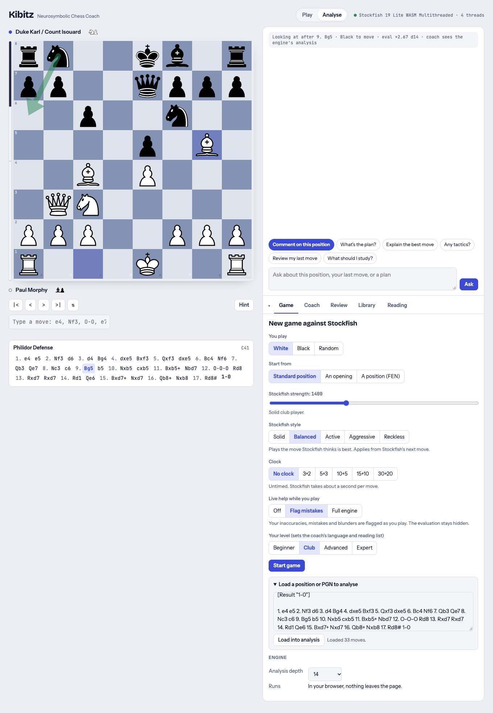
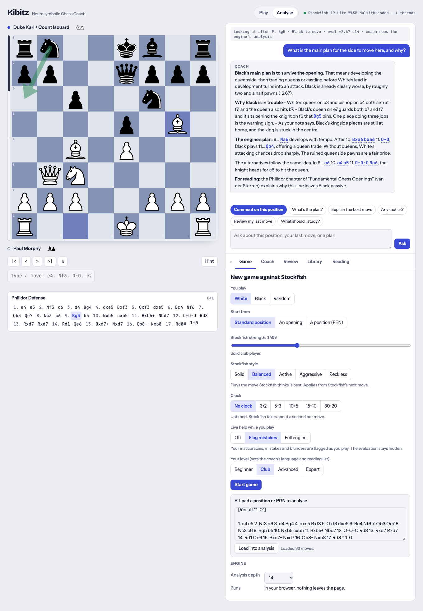
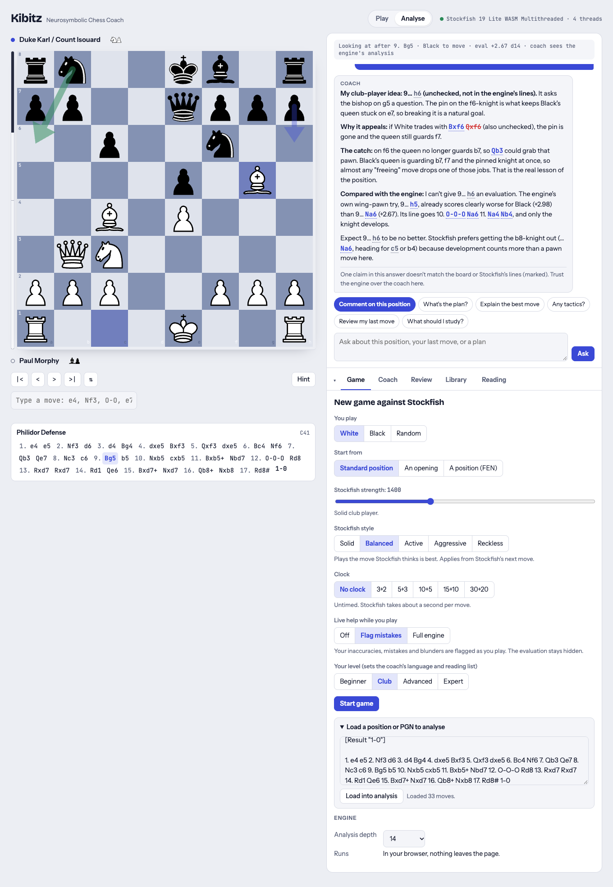
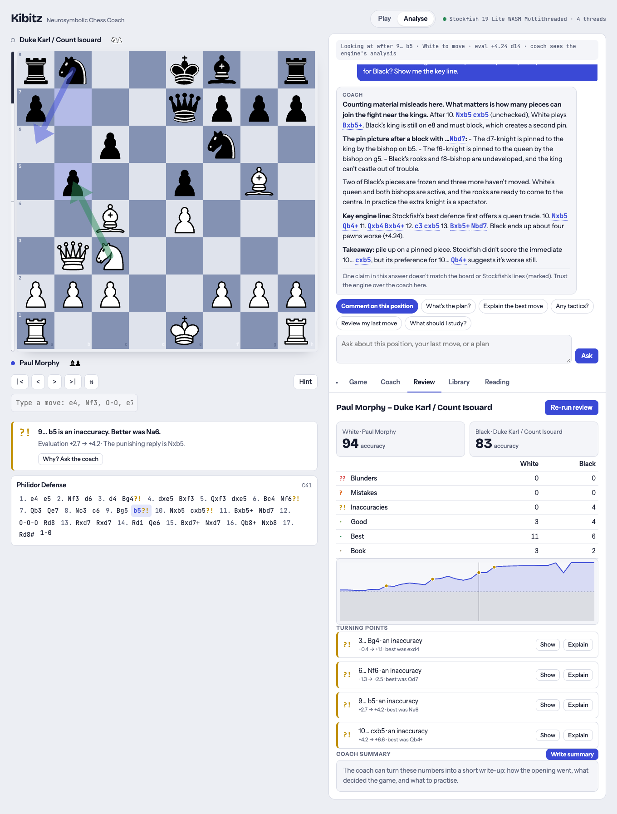
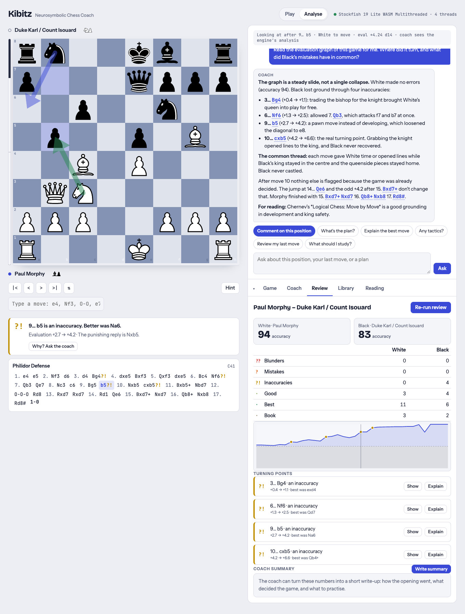
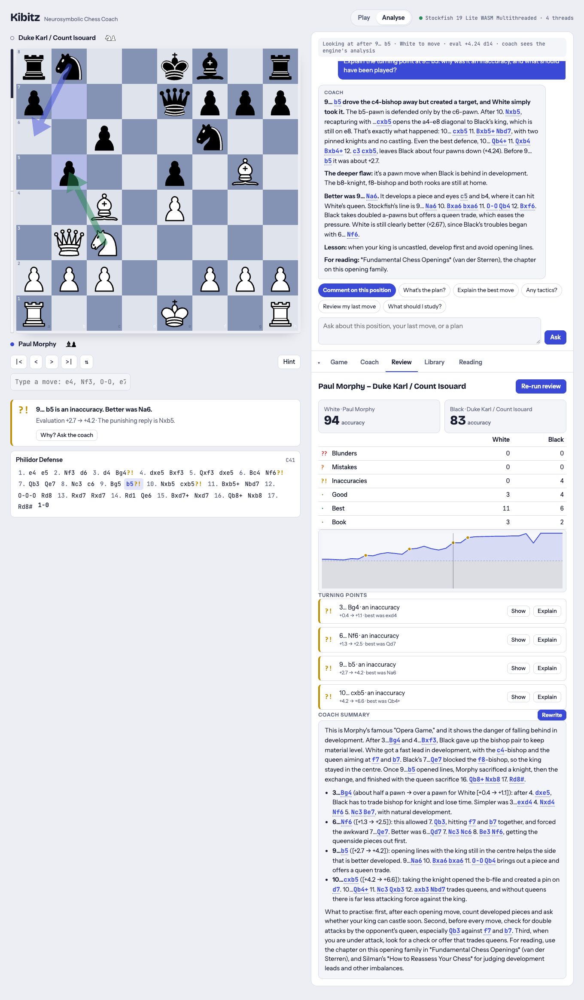
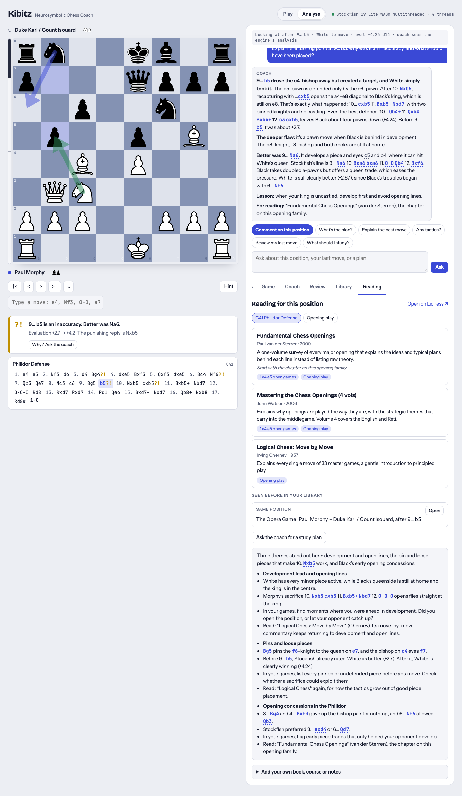
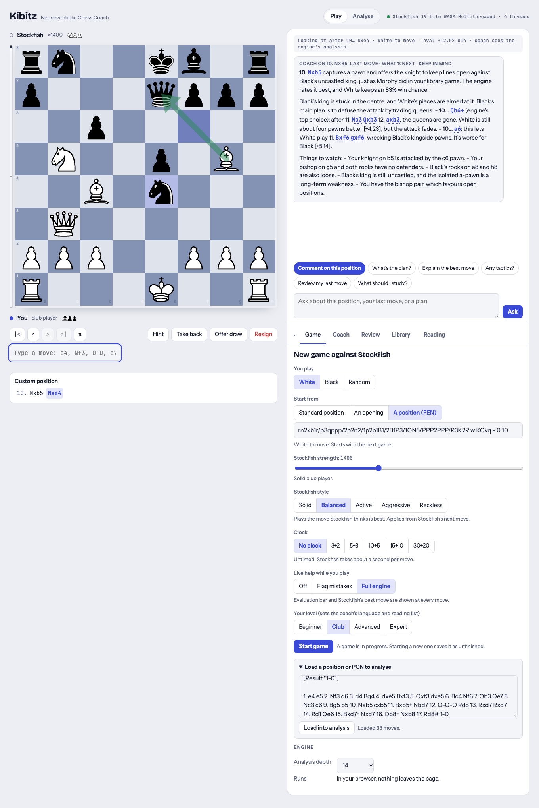

# Kibitz flipbook: the Opera Game, explained

> Generated by `just flipbook` from [site/flipbook/tour.mjs](../../site/flipbook/tour.mjs); don't edit it by hand. To change the walkthrough, edit the tour and run `just flipbook` again (`just flipbook mock` needs no API keys).

**Kibitz** is a neurosymbolic chess coach: Stockfish calculates, and a language model explains. This walkthrough follows one famous game, Morphy's Opera Game (Paris, 1858), to show what the model adds to the engine's numbers. It reads the position and the evaluation graph in words, proposes ideas of its own, and turns the turning points into something a club player can learn from. Everything it says about concrete moves is checked against Stockfish: under each answer, the flipbook counts the moves the engine backs, the legal ones it doesn't list, and the wrong ones, which the app strikes through. How it is built is in [ARCH.md](../ARCH.md).

_11 steps, captured as whole pages from the running app, 1360 pixels wide. The coach is Claude: `claude-opus-5-5` for quick questions, chat and reviews. Stockfish's replies differ between runs, and so do the coach's answers._

## Contents

1. [Load a classic](#1-load-a-classic)
2. [What is the plan?](#2-what-is-the-plan)
3. [The coach's own idea, checked by the engine](#3-the-coachs-own-idea-checked-by-the-engine)
4. [Explain the sacrifice](#4-explain-the-sacrifice)
5. [A follow-up question](#5-a-follow-up-question)
6. [Review: the evaluation graph and the turning points](#6-review-the-evaluation-graph-and-the-turning-points)
7. [The coach reads the graph](#7-the-coach-reads-the-graph)
8. [Explain a turning point](#8-explain-a-turning-point)
9. [The coach's summary](#9-the-coachs-summary)
10. [A study plan from the game](#10-a-study-plan-from-the-game)
11. [Your turn: play the sacrifice yourself](#11-your-turn-play-the-sacrifice-yourself)

## 1. Load a classic

A PGN pasted on the **Game** tab loads into analysis. The level is **Club**, so the coach explains for a club player. The board shows the position after 9. Bg5: White has developed four pieces and is ready to castle queenside, while Black's king and kingside are still at home. Stockfish analyses each position as you step through the moves, and the eval bar beside the board follows.

## 2. What is the plan?

A quick question about the position on the board. The model gets the facts first: the position, Stockfish's top lines with their scores, the motifs in the best move and the player's level. It answers in plans and reasons, not in numbers.

**Question:** What is the main plan for the side to move here, and why?

**Coach:**

> Black's main plan is to survive the opening. That means developing the queenside, then trading queens or castling before White's lead in development turns into an attack. Black is already clearly worse, by roughly two and a half pawns (+2.67).
>
> Why Black is in trouble
> - White's queen on b3 and bishop on c4 both aim at f7, and the queen also hits b7.
> - Black's queen on e7 guards both b7 and f7, and it sits behind the knight on f6 that Bg5 pins. One piece doing three jobs is the warning sign.
> - As your note says, Black's kingside pieces are still at home, and the king is stuck in the centre.
>
> The engine's plan: 9… Na6 develops with tempo. After 10. Bxa6 bxa6 11. O-O, Black plays 11… Qb4, offering a queen trade. Without queens, White's attacking chances drop sharply. The ruined queenside pawns are a fair price.
>
> The alternatives follow the same idea. In 9… a6 10. a4 a5 11. O-O-O Na6, the knight heads for c5 to hit the queen.
>
> For reading: the Philidor chapter of *Fundamental Chess Openings* (van der Sterren) explains why this line leaves Black passive.

_Moves named: 11 moves backed by Stockfish or the game, 1 legal but not in its lines, none wrong._

## 3. The coach's own idea, checked by the engine

Asked for its own idea, the model proposes a move and argues for it. Then it measures the idea against the engine's lines instead of just repeating them. Every move it names is checked with chess.js and against Stockfish's lines. Moves the engine backs are highlighted, legal moves it doesn't list are greyed, and the rest are struck through, including legal moves strung into a line that Stockfish doesn't have. Hovering a move in the answer draws it on the board, as here.

**Question:** Leave Stockfish's first choice aside for a moment. What would you play here as Black, and why? Suggest an idea of your own that a club player would understand, then say honestly how it compares with the engine's lines.

**Coach:**

> My club-player idea: 9… h6 (unchecked, not in the engine's lines). It asks the bishop on g5 a question. The pin on the f6-knight is what keeps Black's queen stuck on e7, so breaking it is a natural goal.
>
> Why it appeals: if White trades with Bxf6 ~~Qxf6~~ (also unchecked), the pin is gone and the queen still guards f7.
>
> The catch: on f6 the queen no longer guards b7, so Qb3 could grab that pawn. Black's queen is guarding b7, f7 and the pinned knight at once, so almost any "freeing" move drops one of those jobs. That is the real lesson of the position.
>
> Compared with the engine: I can't give 9… h6 an evaluation. The engine's own wing-pawn try, 9… h5, already scores clearly worse for Black (+2.98) than 9… Na6 (+2.67). Its line goes 10. O-O-O Na6 11. Na4 Nb4, and only the knight develops.
>
> Expect 9… h6 to be no better. Stockfish prefers getting the b8-knight out (…Na6, heading for c5 or b4) because development counts more than a pawn move here.

_Moves named: 9 moves backed by Stockfish or the game, 4 legal but not in its lines, 1 wrong (struck through)._

## 4. Explain the sacrifice

Black played 9... b5, and Stockfish's answer is 10. Nxb5!, a knight sacrifice. The engine only says that it wins. The coach explains why: which lines open, which black pieces can't join in, and what White threatens next.

**Question:** Explain the idea behind Stockfish's best move in this position.

**Coach:**

> The idea of 10. Nxb5 is to sacrifice the knight to rip open the diagonal to Black's king. Black's 9… b5 attacked the c4-bishop but loosened the a4–e8 diagonal while the king is still on e8. Nxb5 removes the attacking pawn and threatens to break through on c7 and d6.
>
> Why taking back is dangerous: if 10… cxb5 (unchecked), White's bishop recaptures on b5 with check. Black's king is stuck, the f6-knight is pinned and the queenside pieces are undeveloped. White's whole army is already active, so the extra knight hardly matters.
>
> Black's best defence still loses material: 10… Qb4+ 11. Qxb4 Bxb4+ 12. c3 cxb5. Now White's bishop takes on b5 with check while c3 still attacks Black's bishop on b4. That costs Black material, and White ends up about four pawns better (+4.24).
>
> Why Nxb5 before Bxf6: 10. Bxf6 Qxf6 11. Nxb5 cxb5 12. Bxb5+ Nc6 uses the same check, but the early trade releases the pin and frees Black's queen. White's edge is much smaller there, about one and a half pawns (+1.54).
>
> For reading: *Logical Chess: Move by Move* (Chernev) is a gentle introduction to principled play, including the value of development.

_Moves named: 19 moves backed by Stockfish or the game, none wrong._

## 5. A follow-up question

Follow-up questions keep the context: the game, the position and the earlier answers. The key line the model quotes has to match the engine's line to be marked as backed.

**Question:** If Black takes the knight with cxb5, Black is a piece up. Why is that still so bad for Black? Show me the key line.

**Coach:**

> Counting material misleads here. What matters is how many pieces can join the fight near the kings. After 10. Nxb5 cxb5 (unchecked), White plays Bxb5+. Black's king is still on e8 and must block, which creates a second pin.
>
> The pin picture after a block with …Nbd7:
> - The d7-knight is pinned to the king by the bishop on b5.
> - The f6-knight is pinned to the queen by the bishop on g5.
> - Black's rooks and f8-bishop are undeveloped, and the king can't castle out of trouble.
>
> Two of Black's pieces are frozen and three more haven't moved. White's queen and both bishops are active, and the rooks are ready to come to the centre. In practice the extra knight is a spectator.
>
> Key engine line: Stockfish's best defence first offers a queen trade. 10. Nxb5 Qb4+ 11. Qxb4 Bxb4+ 12. c3 cxb5 13. Bxb5+ Nbd7. Black ends up about four pawns worse (+4.24).
>
> Takeaway: pile up on a pinned piece. Stockfish didn't score the immediate 10… cxb5, but its preference for 10… Qb4+ suggests it's worse still.

_Moves named: 14 moves backed by Stockfish or the game, none wrong._

## 6. Review: the evaluation graph and the turning points

The review runs Stockfish over every position. It scores each move, gives both sides an accuracy, draws the evaluation over the game and lists the turning points. This is the symbolic side on its own: exact, and silent about why.

## 7. The coach reads the graph

The model turns the curve into a story: where the evaluation moved, and the pattern behind Black's mistakes. It finds that pattern itself, across moves that the engine scored one at a time.

**Question:** Read the evaluation graph of this game for me. Where did it turn, and what did Black's mistakes have in common?

**Coach:**

> The graph is a steady slide, not a single collapse. White made no errors (accuracy 94). Black lost ground through four inaccuracies:
>
> - 3… Bg4 (+0.4 → +1.1): trading the bishop for the knight brought White's queen into play for free.
>
> - 6… Nf6 (+1.3 → +2.5): allowed 7. Qb3, which attacks f7 and b7 at once.
>
> - 9… b5 (+2.7 → +4.2): a pawn move instead of developing, which loosened the diagonal to e8.
>
> - 10… cxb5 (+4.2 → +6.6): the real turning point. Grabbing the knight opened lines to the king, and Black never recovered.
>
> The common thread: each move gave White time or opened lines while Black's king stayed in the centre and the queenside pieces stayed home. Black never castled.
>
> After move 10 nothing else is flagged because the game was already decided. The jump at 14… Qe6 and the odd +4.2 after 15. Bxd7+ don't change that. Morphy finished with 15. Bxd7+ Nxd7 16. Qb8+ Nxb8 17. Rd8#.
>
> For reading: Chernev's *Logical Chess: Move by Move* is a good grounding in development and king safety.

_Moves named: 12 moves backed by Stockfish or the game, none wrong._

## 8. Explain a turning point

Each turning point has an **Explain** button. The coach gets the position before the move, the move played, the engine's better move with its line, and the motifs that refute the mistake.

**Question:** Explain the turning point at 9… b5: why was it an inaccuracy, and what should have been played?

**Coach:**

> 9… b5 drove the c4-bishop away but created a target, and White simply took it. The b5-pawn is defended only by the c6-pawn. After 10. Nxb5, recapturing with …cxb5 opens the a4–e8 diagonal to Black's king, which is still on e8. That's exactly what happened: 10… cxb5 11. Bxb5+ Nbd7, with two pinned knights and no castling. Even the best defence, 10… Qb4+ 11. Qxb4 Bxb4+ 12. c3 cxb5, leaves Black about four pawns down (+4.24). Before 9… b5 it was about +2.7.
>
> The deeper flaw: it's a pawn move when Black is behind in development. The b8-knight, f8-bishop and both rooks are still at home.
>
> Better was 9… Na6. It develops a piece and eyes c5 and b4, where it can hit White's queen. Stockfish's line is 9… Na6 10. Bxa6 bxa6 11. O-O Qb4 12. Bxf6. Black takes doubled a-pawns but offers a queen trade, which eases the pressure. White is still clearly better (+2.67), since Black's troubles began with 6… Nf6.
>
> Lesson: when your king is uncastled, develop first and avoid opening lines.
>
> For reading: *Fundamental Chess Openings* (van der Sterren), the chapter on this opening family.

_Moves named: 20 moves backed by Stockfish or the game, 1 legal but not in its lines, none wrong._

## 9. The coach's summary

A short write-up of the whole game: the opening, what decided it, and what to practise. The model gets the turning points, the best moves and the motifs, and the references retrieved for the game's themes, and only explains them.

**Coach summary:**

> This is Morphy's famous "Opera Game," and it shows the danger of falling behind in development. After 3…Bg4 and 4…Bxf3, Black gave up the bishop pair to keep material level. White got a fast lead in development, with the c4-bishop and the queen aiming at f7 and b7. Black's 7…Qe7 blocked the f8-bishop, so the king stayed in the centre. Once 9…b5 opened lines, Morphy sacrificed a knight, then the exchange, and finished with the queen sacrifice 16. Qb8+ Nxb8 17. Rd8#.
>
> - 3…Bg4 (about half a pawn → over a pawn for White [+0.4 → +1.1]): after 4. dxe5, Black has to trade bishop for knight and lose time. Simpler was 3…exd4 4. Nxd4 Nf6 5. Nc3 Be7, with natural development.
>
> - 6…Nf6 ([+1.3 → +2.5]): this allowed 7. Qb3, hitting f7 and b7 together, and forced the awkward 7…Qe7. Better was 6…Qd7 7. Nc3 Nc6 8. Be3 Nf6, getting the queenside pieces out first.
>
> - 9…b5 ([+2.7 → +4.2]): opening lines with the king still in the centre helps the side that is better developed. 9…Na6 10. Bxa6 bxa6 11. O-O Qb4 brings out a piece and offers a queen trade.
>
> - 10…cxb5 ([+4.2 → +6.6]): taking the knight opened the b-file and created a pin on d7. 10…Qb4+ 11. Nc3 Qxb3 12. axb3 Nbd7 trades queens, and without queens there is far less attacking force against the king.
>
> What to practise: first, after each opening move, count developed pieces and ask whether your king can castle soon. Second, before every move, check for double attacks by the opponent's queen, especially Qb3 against f7 and b7. Third, when you are under attack, look for a check or offer that trades queens. For reading, use the chapter on this opening family in *Fundamental Chess Openings* (van der Sterren), and Silman's *How to Reassess Your Chess* for judging development leads and other imbalances.

_Moves named: 44 moves backed by Stockfish or the game, none wrong._

## 10. A study plan from the game

The **Reading** tab lists the position's themes and the books and classic games that teach them, found by position, pawn structure and theme. From these, the coach writes a study plan that fits the player's level.

**Study plan:**

> Three themes stand out here: development and open lines, the pin and loose pieces that make 10. Nxb5 work, and Black's early opening concessions.
>
> - Development lead and opening lines
>
> - White has every minor piece active, while Black's queenside is still at home and the king is in the centre.
>
> - Morphy's sacrifice 10. Nxb5 cxb5 11. Bxb5+ Nbd7 12. O-O-O opens files straight at the king.
>
> - In your games, find moments where you were ahead in development. Did you open the position, or let your opponent catch up?
>
> - Read: *Logical Chess: Move by Move* (Chernev). Its move-by-move commentary keeps returning to development and open lines.
>
> - Pins and loose pieces
>
> - Bg5 pins the f6-knight to the queen on e7, and the bishop on c4 eyes f7.
>
> - Before 9… b5, Stockfish already rated White as better (+2.7). After it, White is clearly winning (+4.24).
>
> - In your games, list every pinned or undefended piece before you move. Check whether a sacrifice could exploit them.
>
> - Read: *Logical Chess* again, for how the tactics grow out of good piece placement.
>
> - Opening concessions in the Philidor
>
> - 3… Bg4 and 4… Bxf3 gave up the bishop pair for nothing, and 6… Nf6 allowed Qb3.
>
> - Stockfish preferred 3… exd4 or 6… Qd7.
>
> - In your games, flag early piece trades that only helped your opponent develop.
>
> - Read: *Fundamental Chess Openings* (van der Sterren), the chapter on this opening family.

_Moves named: 18 moves backed by Stockfish or the game, none wrong._

## 11. Your turn: play the sacrifice yourself

A new game from the position after 9... b5, against Stockfish, with the coach set to comment after every move. You play 10. Nxb5, Stockfish replies, and the coach comments beside the board. In a game, the help setting limits what the coach sees. Here it is **Full engine**, so the coach gets Stockfish's lines; with **Flag mistakes** it would only learn how your move rated, so it couldn't give the game away.

**Coach on 10. Nxb5: Last move · What's next · Keep in mind:**

> 10. Nxb5 captures a pawn and offers the knight to keep lines open against Black's uncastled king, just as Morphy did in your library game. The engine rates it best, and White keeps an 83% win chance.
>
> Black's king is stuck in the centre, and White's pieces are aimed at it. Black's main plan is to defuse the attack by trading queens:
> - 10… Qb4+ (engine's top choice): after 11. Nc3 Qxb3 12. axb3, the queens are gone. White is still about four pawns better [+4.23], but the attack fades.
> - 10… a6: this lets White play 11. Bxf6 gxf6, wrecking Black's kingside pawns. It's worse for Black [+5.14].
>
> Things to watch:
> - Your knight on b5 is attacked by the c6 pawn.
> - Your bishop on g5 and both rooks have no defenders.
> - Black's rooks on a8 and h8 are also loose.
> - Black's king is still uncastled, and the isolated a-pawn is a long-term weakness.
> - You have the bishop pair, which favours open positions.

_Moves named: 8 moves backed by Stockfish or the game, none wrong._
