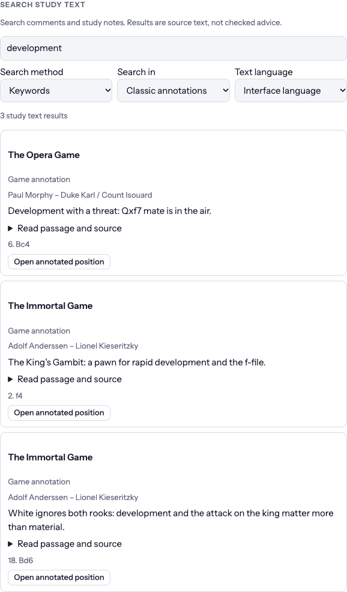
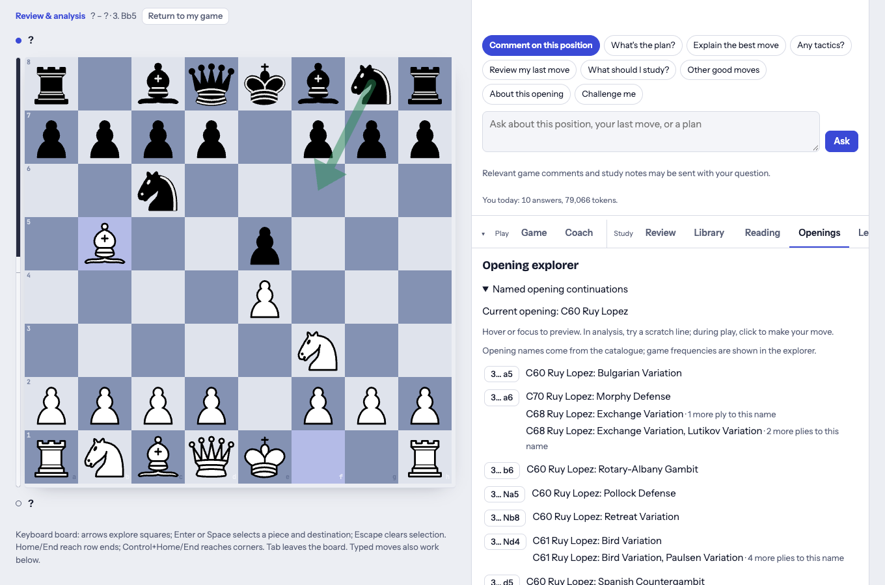
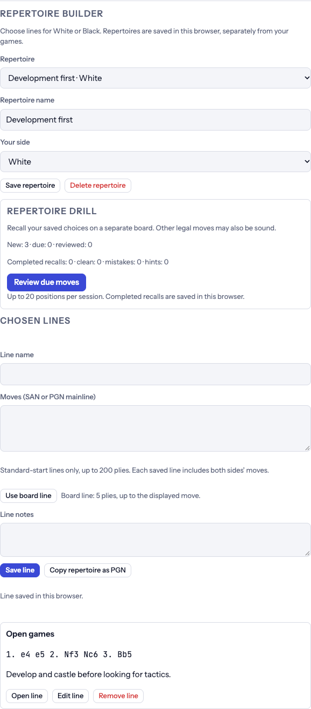
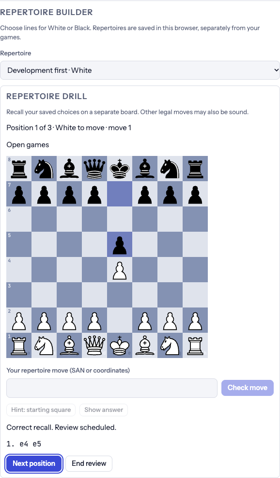
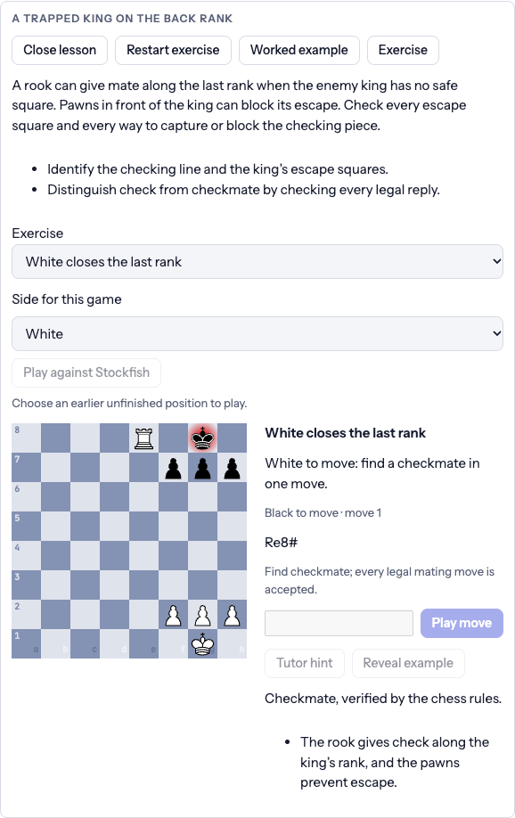
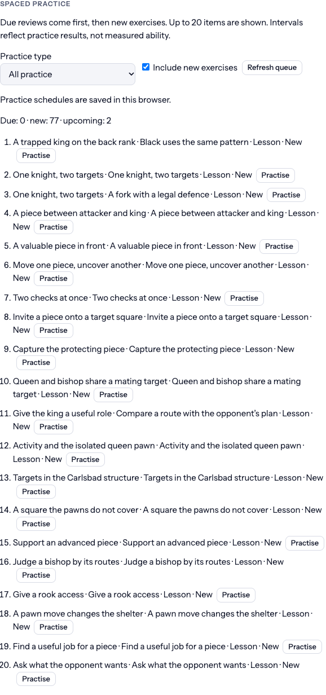
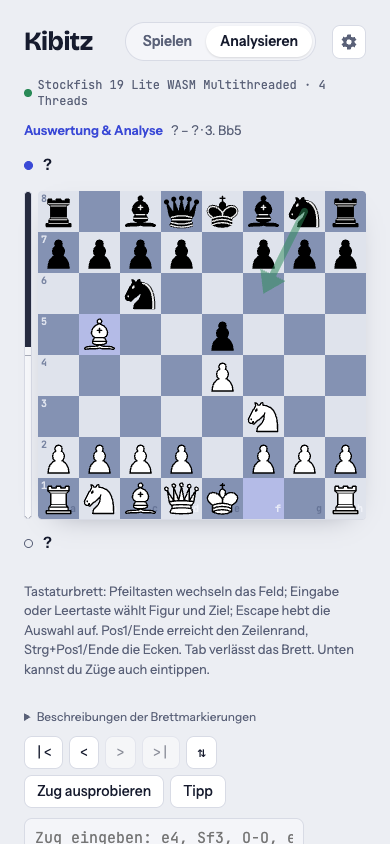
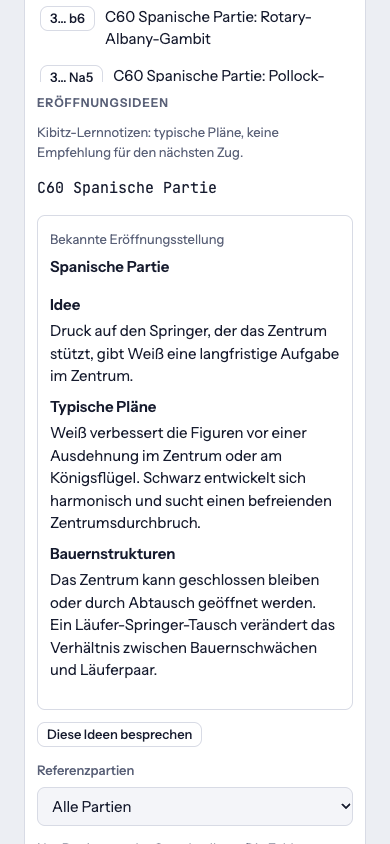

# Kibitz flipbook: the Opera Game, explained

> Generated by `just flipbook` from [site/flipbook/tour.mjs](../../site/flipbook/tour.mjs); don't edit it by hand. To change the walkthrough, edit the tour and run `just flipbook` again (`just flipbook mock` needs no API keys).

**Kibitz** is a neurosymbolic chess coach: Stockfish calculates, and a language model explains. This walkthrough follows one famous game, Morphy's Opera Game (Paris, 1858), to show what the model adds to the engine's numbers. It reads the position and the evaluation graph in words, proposes ideas of its own, and turns the turning points into something a club player can learn from. Recognized moves are checked against chess.js and captured engine/game evidence. Red underlines flag tokens the checker could not validate; legal moves outside the evidence remain unverified. These checks do not certify every prose claim. The walkthrough then follows the current library, opening repertoire, lessons and spaced practice, ending with the German phone interface. How it is built is in [ARCH.md](../ARCH.md).

_19 screenshots captured on 2026-10-24 from the running app. Desktop viewport: 1360 × 900; focused panels keep long review/study sections readable. German phone views: 390 × 844. The coach is Claude: `claude-haiku-5-5` for quick questions, chat and reviews. Stockfish's replies and model answers can differ between runs. Quoted text uses coach-prose-v2 capture, excluding source/tool/interface cards._

## Contents

1. [Load a classic](#1-load-a-classic)
2. [What is the plan?](#2-what-is-the-plan)
3. [The coach's own idea, checked by the engine](#3-the-coachs-own-idea-checked-by-the-engine)
4. [Explain the sacrifice](#4-explain-the-sacrifice)
5. [A follow-up question](#5-a-follow-up-question)
6. [Review: the evaluation graph and the turning points](#6-review-the-evaluation-graph-and-the-turning-points)
7. [The coach reads the graph](#7-the-coach-reads-the-graph)
8. [Explain a turning point](#8-explain-a-turning-point)
9. [The coach's summary](#9-the-coachs-summary)
10. [A study plan from the game](#10-a-study-plan-from-the-game)
11. [Your turn: play the sacrifice yourself](#11-your-turn-play-the-sacrifice-yourself)
12. [Find the source behind an idea](#12-find-the-source-behind-an-idea)
13. [Opening names, continuations and plans](#13-opening-names-continuations-and-plans)
14. [Keep a repertoire with your own notes](#14-keep-a-repertoire-with-your-own-notes)
15. [Recall a move on a separate board](#15-recall-a-move-on-a-separate-board)
16. [Practise a rule-checked lesson](#16-practise-a-rule-checked-lesson)
17. [Return to the next useful practice](#17-return-to-the-next-useful-practice)
18. [Study in German on a phone](#18-study-in-german-on-a-phone)
19. [Read the opening guide in German](#19-read-the-opening-guide-in-german)

## 1. Load a classic

A PGN pasted on the **Game** tab loads into analysis. The level is **Club**, so the coach explains for a club player. The board shows the position after 9. Bg5: White has developed four pieces and is ready to castle queenside, while Black's king and queenside remain on the back rank. Stockfish analyses each position as you step through the moves, and the eval bar beside the board follows.

## 2. What is the plan?

A quick question about the position on the board. The model gets the facts first: the position, Stockfish's top lines with their scores, the motifs in the best move and the player's level. It answers in plans and reasons, not in numbers.

**Question:** What is the main plan for the side to move here, and why?

**Coach:**

> Black's main plan is to catch up in development and get the king safe, and 9... Na6 is the engine's choice. Black is behind in development: as the Opera Game notes, "every White piece is developed; Black's kingside pieces are still at home" [1]. Black's Bg4 was traded early, so the queenside knight has to come out, and Na6 heads for the bishop on c4.
>
> The engine line is 9... Na6 10. Bxf6 gxf6 11. Bxa6 bxa6 12. O-O Qb4 13. Rfd1, with White about two and a half pawns better [+2.57]. Black gets the bishop pair traded, but the doubled f-pawns and the open g-file make the kingside awkward. Black is objectively worse here, so the aim is to limit the damage, not to win material.
>
> The alternative 9... h5 is about half a pawn worse by the engine's count [+3.14], so it's not a better way to defend. Your study notes suggest Black should contest open files and develop with threats, but here the most practical move is simply getting the knight into play.

_Recognized move tokens: 12 matching captured engine/game evidence, none flagged. These checks do not certify every prose claim._

## 3. The coach's own idea, checked by the engine

Asked for its own idea, the model proposes a move and argues for it. Then it measures the idea against the engine's lines instead of just repeating them. Recognized moves are checked with chess.js and against captured Stockfish/game evidence. Matching moves are highlighted, legal moves outside the evidence are greyed, and failed checks have a red underline. A flagged token can also be a piece reference or an impossible move discussed as such. Hovering a move in the answer draws it on the board, as here.

**Question:** Consider a candidate other than Stockfish's first choice for Black. Use the engine tools to compare it with the best move, then explain the trade-off to a club player. Quote only continuations supplied by the engine and say when evidence is missing.

**Coach:**

> Trade-off: 9... a6 is playable, but it costs about half a pawn compared with 9... Na6.
>
> Stockfish rates 9... Na6 at about +2.74 for White, with the line 10. Bxa6 bxa6 11. Bxf6 gxf6 12. O-O. After 9... a6 the evaluation is about +3.16 [loss 0.42 pawns]. Stockfish's reply line is 10. a4 Qc7 11. a5 Bc5 12. O-O Rf8. The compare check of 9... a6 gave +3.06, so the two results are consistent.
>
> The idea behind a6 is to stop Bb5 and prepare ...b5 or ...Bc5, keeping the knight flexible. The problem is that it spends a tempo on the edge while White is already ahead in development. Black's kingside pieces are still at home, as the Opera Game notes show [1]. White can use a4-a5 to gain queenside space, and Black has not yet got a piece out.
>
> Na6 is better because it brings a piece into play at once and aims at the bishop on c4. The engine's preference is the more active move. The 9... h5 alternative is about +3.03 [compare check] and is also worse, so neither a6 nor h5 solves Black's development problem.

_Recognized move tokens: 25 matching captured engine/game evidence, 1 legal but outside that evidence, none flagged. These checks do not certify every prose claim._

## 4. Explain the sacrifice

Black played 9... b5, and Stockfish's answer is 10. Nxb5!, a knight sacrifice. The engine supplies the evaluation and concrete lines. The coach explains the development and king-safety ideas; its explanation remains subject to the evidence and checks shown in the app.

**Question:** Explain the idea behind Stockfish's best move in this position.

**Coach:**

> The idea is to win the b5 pawn with the knight and open the e8 king's diagonal. Black's ...b5 attacks the bishop on c4, so White must act. 10. Nxb5 removes that attacker and takes a pawn. The engine's main line is 10. Nxb5 Qb4+ 11. Qxb4 Bxb4+ 12. c3 cxb5 13. Bxb5+ Nbd7, where White is about four and a half pawns better [+4.49].
>
> The point is what happens after ...cxb5. The c6 pawn has left the diagonal, so 13. Bxb5+ gives check on the e8 king and wins back the material. Black's ...Qb4+ is a forcing try that trades queens, but the engine still keeps White well ahead after the sequence.
>
> Black's Qe7 and undeveloped kingside are the underlying problem. Black is still behind in development, so the king on e8 cannot easily escape the check on the diagonal.
>
> The retrieved passages do not cover this position, so I have no citation for this explanation. The evaluation comes from the supplied Stockfish lines.

_Recognized move tokens: 14 matching captured engine/game evidence, none flagged. These checks do not certify every prose claim._

## 5. A follow-up question

Follow-up questions keep the context: the game, the position and the earlier answers. The key line the model quotes has to match the engine's line to be marked as backed.

**Question:** If Black takes the knight with cxb5, Black is a piece up. Why is that still so bad for Black? Show me the key line.

**Coach:**

> Black wins a knight, but loses the queen trade, a second pawn and then the bishop. The engine line is 10. Nxb5 Qb4+ 11. Qxb4 Bxb4+ 12. c3 cxb5 13. Bxb5+ Nbd7, and White is about four and a half pawns better [+4.49].
>
> Black takes the knight, but the queens come off first. After 12. c3 the bishop on b4 is attacked, and Black plays 12... cxb5 instead of retreating it. White's 13. Bxb5+ is check, so Black must block with 13... Nbd7, and the bishop on b4 is still hanging. Black ends up roughly a knight for two pawns, then loses the bishop too. Black's king is still in the centre and its pieces are undeveloped, as the Opera Game notes show [2].
>
> Your question asks about 10... cxb5 played immediately. The supplied engine lines do not include that move, so I can't give its evaluation. The line above is the one the engine checked.

_Recognized move tokens: 13 matching captured engine/game evidence, none flagged. These checks do not certify every prose claim._

## 6. Review: the evaluation graph and the turning points

The review runs Stockfish over every position. It scores each move, gives both sides an accuracy, draws the evaluation over the game and lists the turning points. These are engine measurements, separate from the model's explanation; scores and classifications can change with search depth.

## 7. The coach reads the graph

The model turns the curve into a story: where the evaluation moved, and the pattern behind Black's mistakes. It finds that pattern itself, across moves that the engine scored one at a time.

**Question:** Read the evaluation graph of this game for me. Where did it turn, and what did Black's mistakes have in common?

**Coach:**

> The graph turns at 9... b5, and the collapse is completed by 10... cxb5. Through move 8 the game stays near +2.5 to +3 for White, which is a normal edge for a side with a lead in development. The biggest jumps come at 6... Nf6 (+1.3 to +2.8), 9... b5 (+2.6 to +4.5) and 10... cxb5 (+4.5 to +7.5). After 10... cxb5 the game is effectively decided, and the review shows a further jump to +13.0 after 14... Qe6.
>
> Black's mistakes share a pattern. Each one spent a tempo on queen or pawn moves while the king stayed in the centre and the kingside pieces stayed at home. The 4... Bxf3 inaccuracy gave up the bishop pair, and the 6... Nf6 mistake let White's pieces develop with tempo. The later pawn moves opened lines toward Black's own king.
>
> The study note on the Italian Game makes the same point: a bishop aimed at the king is useful only when the rest of the army can join [3]. Black's bishop on c8 was never really part of the defence.

_Recognized move tokens: 9 matching captured engine/game evidence, none flagged. These checks do not certify every prose claim._

## 8. Explain a turning point

Each turning point has an **Explain** button. The coach gets the position before the move, the move played, the engine's better move with its line, and the motifs that refute the mistake.

**Question:** Explain the turning point at 9… b5: why was it a mistake, and what should have been played?

**Coach:**

> 9... b5 was a mistake because it spent a tempo on a pawn move while Black was still behind in development. Before the move the evaluation was about +2.6 for White. After it, the engine rates the position at +4.5 [Stockfish review]. The pawn attacks the bishop on c4, but White answers with 10. Nxb5, and the knight wins the pawn with tempo. After 10... Qb4+ 11. Qxb4 Bxb4+ 12. c3 cxb5 13. Bxb5+ Nbd7, the engine has White about four and a half pawns better [+4.49]. This is the same problem the study note describes: Black should avoid falling behind in development [1].
>
> The better move was 9... Na6. It develops the last undeveloped queenside knight. The engine line is 10. Bxf6 gxf6 11. Bxa6 bxa6 12. O-O, which it rates at about +2.57 for White [Stockfish preferred line]. That is still a clear White advantage, but about two pawns less than after 9... b5.
>
> Black's main problem is not the b-pawn itself. It is that Black still has Qe7 and an uncastled king while White's pieces are active. Black needed a developing move, not a pawn push.

_Recognized move tokens: 17 matching captured engine/game evidence, none flagged. These checks do not certify every prose claim._

## 9. The coach's summary

A short write-up of the whole game: the opening, what decided it, and what to practise. The model gets the turning points, the best moves and the motifs, and the references retrieved for the game's themes, and only explains them.

**Coach summary:**

> Morphy's opening play was direct. After 3. d4 Bg4 4. dxe5, he traded into an open position and used the queen and rook on the d-file while Black's pieces stayed awkwardly placed. Black was slightly less accurate throughout, and the game ended with 17. Rd8#. Accuracy: White 93, Black 82.
>
> - 4... Bxf3 (inaccuracy, about a pawn for White, +1.0 → +1.6): Trading the bishop let 5. Qxf3 win a loose piece's worth of activity. Better was 4... Nd7 5. exd6 Bxd6 6. Nc3 Ngf6, which keeps Black's pieces coordinated.
>
> - 6... Nf6 (mistake, +1.3 → +2.8): This allowed White to keep the initiative. Better was 6... Qf6 7. Qh3 Nd7 8. Nc3 Bc5, defending first and developing with purpose.
>
> - 9... b5 (mistake, +2.6 → +4.5): The pawn lunge loosened Black's queenside and gave White targets. Better was 9... Na6 10. Bxf6 gxf6 11. Bxa6 bxa6.
>
> - 10... cxb5 (mistake, +4.5 → +7.5): Recapturing opened the c-file toward Black's king, and White's O-O-O and pressure decided the game. Better was 10... Na6 11. O-O-O Nc5 12. Qf3 Nb7.
>
> What to practise: Before any pawn break or recapture, ask which files and diagonals open toward your king, as in the 9...b5 and 10...cxb5 sequence. Second, count development and loose pieces before trading, as in 4...Bxf3. Third, study how pawn structure shapes plans, since the game featured isolated, doubled and passed pawns. For the structure ideas, read the passed-pawn and blockade sections of Nimzowitsch's *My System*. For the opening, read the chapter on this opening family in van der Sterren's *Fundamental Chess Openings*.

_Recognized move tokens: 33 matching captured engine/game evidence, none flagged. These checks do not certify every prose claim._

## 10. A study plan from the game

The **Reading** tab lists the position's themes and the books and classic games that teach them, found by position, pawn structure and theme. From these, the coach writes a study plan that fits the player's level.

**Study plan:**

> Step 1: Development before material. This position is about open-game play: Morphy gave up material to keep lines open and develop every piece. Review your own games for moves where you grabbed a piece or pawn while your pieces stayed at home. The engine rated 4...Bxf3 an inaccuracy, since 5. Qxf3 [+1.6] exploited the loose bishop. Read *Logical Chess: Move by Move* by Irving Chernev, which explains each move of its master games. Then play through The Opera Game for the same idea in action.
>
> Step 2: King safety and pawn pushes. Black's 9...b5 was rated a mistake. The engine preferred 9...Na6 [+2.57] because it kept the king's pawn shelter intact. In your games, check whether you push pawns in front of your own king while the opponent's pieces aim at it. Read the chapter on this opening family in *Fundamental Chess Openings* by Paul van der Sterren, which explains the typical plans behind these structures.
>
> Step 3: Loose pieces. The position has several undefended pieces, including White's bishop on g5 and both rooks on a1 and h1. Before each move in your own games, list every piece that has no defender and check whether an opponent's check, capture, or fork can reach it. Use *Mastering the Chess Openings* by John Watson for the strategic background. The references don't say which volume covers 1.e4 e5, so check the set's contents before choosing one.

_Recognized move tokens: 6 matching captured engine/game evidence, none flagged. These checks do not certify every prose claim._

## 11. Your turn: play the sacrifice yourself

A new game from the position after 9... b5, against Stockfish, with the coach set to comment after the player's moves. You play 10. Nxb5, Stockfish replies, and the coach comments beside the board. In a game, the help setting limits what the coach sees. Here it is **Full engine**, so the coach gets Stockfish's lines; with **Flag mistakes** it would only learn how your move rated, so it couldn't give the game away.

**Coach on 10. Nxb5: Last move · What's next · Keep in mind:**

> Last move: 10. Nxb5 won a pawn and kept the knight active, and the engine rates it as its top choice. After Black's best replies, White stays about four and a half pawns ahead [+4.46 to +4.57]. The engine gives no alternative to 10. Nxb5, so I can't compare it.
>
> What's next: Black's pawn on c6 attacks the knight, and 10... Qb4+ is the most forcing reply. The engine line runs 11. Qxb4 Bxb4+ 12. c3. White's plan is to finish development and castle. If Black plays 10... Na6, the engine's line is 11. O-O-O, which connects the rooks and keeps the lines open. White should also watch the loose pieces: both sides have rooks and a bishop that can be picked off.
>
> Keep in mind: Black's rooks on a8 and h8 have no defenders, and White's ~~Bg5~~, ~~Ra1~~ and ~~Rh1~~ are also undefended. Black has an isolated a-pawn, so Black's plans have to be built around the pawns actually on the board [S32838cc7880.2]. White holds the bishop pair, which helps in open positions. Both kings are still in the centre, so king safety decides a lot.

_Recognized move tokens: 8 matching captured engine/game evidence, 3 flagged by the checker (red underline in the app; marked ~~…~~ in this transcript). These checks do not certify every prose claim._

## 12. Find the source behind an idea

Pause the game for analysis, then search literal annotations in the bundled classics. Each passage carries its source and supplied licence and opens its exact game occurrence. Keyword search runs locally; a matching passage identifies source text without proving the coach's explanation.

## 13. Opening names, continuations and plans

The Openings tab follows the current board: named catalogue continuations, original guides and the reference-game explorer answer different questions. Here the Ruy Lopez supplies a concrete starting point for a repertoire. Catalogue names and counts are reference data, rather than fresh engine verdicts.

## 14. Keep a repertoire with your own notes

Save legal lines for White or Black, with a name and personal notes. Repertoires stay in this browser and keep the loaded game intact. Saved choices define what to recall; they are not an assertion that every alternative is bad chess.

## 15. Recall a move on a separate board

Review due repertoire moves on an independent board. A saved move is accepted and the recorded opponent reply follows. Hints, mistakes and clean recalls determine the next review date; the session does not call the model or alter the main game.

## 16. Practise a rule-checked lesson

Lessons have their own board, authored explanations and staged hints. This back-rank mate is verified by chess.js after the move. Strategy reflections, recorded source lines and verified mates retain different result labels instead of sharing a guessed model grade.

## 17. Return to the next useful practice

The practice queue combines lesson progress, repertoire recalls and saved exercises from reviewed mistakes. Due work and new material remain separate; completed recalls and next review dates persist in this browser. These are practice records, not a measured chess rating.

## 18. Study in German on a phone

The same saved study works in the German phone interface, with translated opening labels/guides and optional German move letters. Display notation is separate from canonical SAN in saved PGNs and engine data. Saved repertoires and practice survive the language reload.

## 19. Read the opening guide in German

The phone view also keeps the authored opening guide readable in German. Ideas, typical plans and pawn-structure notes are authored study material; concrete moves still need the engine's evidence. These pages are screenshots of the actual localized app.
